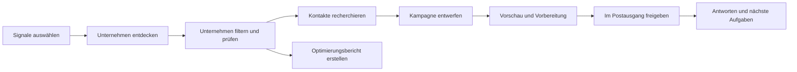

# Siveron — B2B Research & Outreach Workspace

Siveron verbindet Unternehmensrecherche, evidenzbasierte Signale, Kontaktverwaltung,
KI-gestützte Auswertungen und kontrollierte Kampagnen in einer lokal betriebenen
Weboberfläche. Die Benutzeroberfläche und die integrierte Hilfe unterstützen
**Deutsch und Englisch**.

**Produktentwicklung und lokale Erweiterungen: Bao Dang.** Ausgangspunkt ist
[Harvey von Ethan Rogers](https://github.com/ethanplusai/harvey), v0.3.0
(`e2632eb`). Anwendung und eigene Änderungen bleiben unter der **MIT-Lizenz**.
Drittanbieter-Komponenten behalten ihre jeweiligen Lizenzen.

[Handbuch DE](docs/HANDBUCH_DE.md) · [User guide EN](docs/USER_GUIDE_EN.md) ·
[Architektur](docs/ARCHITECTURE.md) · [Roadmap](docs/ROADMAP.md) ·
[Autoren](AUTHORS.md) · [Lizenzen](THIRD_PARTY.md)

## Was die Plattform bietet

| Bereich | Funktionen |
| --- | --- |
| Heute | Überblick über Unternehmen, Kontakte, Signale und anstehende Entscheidungen |
| Entdecken | Unternehmenssuche nach Begriffen, Ort und Radius; Datenquellenauswahl; Vorschau; Suchlimits; anhaltbare Suchläufe und kompakte Fortschrittsdetails |
| Datenquellen | Providerbasierte Suche einschließlich OpenStreetMap, optionaler API-Anbieter und lokaler Google-Maps-Browsersuche; Verfügbarkeit und Grenzen unterscheiden sich je Quelle |
| Signale und Zielgruppen | Explizite Aktivierung von Merkmalen; gespeicherte Beobachtungen; Kohorten und Zielprofile mit „passt“, „passt nicht“ und „unbekannt“ |
| Unternehmen | Filter, gespeicherte Ansichten, öffentliche E-Mail-Suche, Unternehmensprofile, Quellen und Prüfinformationen, Einzel- und Sammelaktionen, rückgängig machbare Entfernung |
| Kontaktrecherche | Öffentliche Websites, Web-Suche und Profilhinweise; optionale Hunter-Anbindung; Suchbudgets und Limits; nachvollziehbare Quellen und ausdrückliche Übernahme von Funden |
| Entscheider und Kontakte | Ansprechpartner recherchieren und prüfen; Firmen- und Personenkontakte; Auswahl bekannter E-Mail-Adressen; Notizen, Kontaktsperren und Papierkorb |
| Optimierungsberichte | Unternehmensberichte aus gespeicherten Signalen; offene Prüfpunkte statt erfundener Befunde; optionale KI-Erläuterung zu Sichtbarkeit, KI-Suche und Kundengewinnung; Markdown und Druck/PDF |
| KI-Assistent | Natürlichsprachige Suchvorschläge, Bedienhilfe und Auswertungen vorhandener Daten; individuell einstellbare Funktionen, Sprache, Antwortlänge und Gesprächskontext |
| Kampagnen | Entwürfe, Rich-Text-Nachrichten, Platzhalter, Anhänge, Folgenachrichten, Vorlagen und geführte Vorbereitung |
| Postausgang | Prüfung, ausdrückliche Freigaben, Versandbereitschaft und geplante Sequenzen über konfigurierte Mail-Anbindungen |
| Unterhaltungen und Vertrieb | Kampagnenbezogene Gesprächsansicht, Verkaufschancen, nächste Aufgaben und explizite Ergebnisbewertung |
| Einstellungen und Hilfe | Lokale Integrationsverwaltung, Nutzung, Agentensteuerung und ausführliche DE/EN-Workflow-Dokumentation |

## Typischer Workflow



Der Assistent kann Suchkriterien vorschlagen und gespeicherte Daten auswerten.
Er startet durch die Übernahme eines Suchvorschlags keine Suche und erhält dadurch
keine zusätzlichen Berechtigungen. Berichte arbeiten mit gespeicherten Belegen;
ein Bericht ist keine neue vollständige Website-Prüfung.

## Lokal starten

Das Repository enthält **keine mitgelieferten Zugangsdaten, Kundenbestände oder
konfigurierten Absenderidentitäten**. Die öffentliche Entwicklungsvorlage ist neutral:
E-Mail und LinkedIn deaktiviert, Versandlimit null, Freigaben erforderlich.

```bash
git clone https://github.com/nexdevn-dot/SIveron_Hervay2.0.git
cd SIveron_Hervay2.0
bash scripts/setup.sh
bash scripts/doctor.sh
bash scripts/dashboard.sh
```

Dashboard: **http://127.0.0.1:5555/**. Der Dashboard-Start allein ist keine
Freigabe zum Starten von Kampagnen oder zum Versenden von Nachrichten.
Siehe [START_HERE_DE.md](START_HERE_DE.md) für die Einrichtung und verbleibende
Schritte vor dem Live-Einsatz. Python und die gepinnte Codex-CLI werden lokal
verwaltet; die globale Codex-Installation bleibt unverändert.

```bash
bash scripts/test.sh -q
scripts/harvey status
scripts/codex --version
```

Technische Paketnamen und CLI-Pfade verwenden aus Kompatibilitätsgründen weiterhin
`harvey`. Die Produktoberfläche heißt Siveron.

## Konfiguration und KI

- `config/development.yaml`: öffentliche, neutrale Entwicklungsvorlage.
- `harvey.local.yaml`: private lokale Konfiguration, nicht versioniert.
- `.env`: private Integrationszugänge, nicht versioniert; `.env.example` enthält leere Felder.
- SQLite-Zustand, Authentifizierungsdateien, Exporte und Produktwissen bleiben lokal.
- KI-Anbindung über die vorhandene Claude-/Codex-Integration; benötigt einen
  geeigneten Zugang und unterliegt dessen Nutzungsgrenzen. Externe Recherche- und
  Verifikationsanbieter können zusätzliche Kosten verursachen.
- Die gepinnte Codex-Version und ihre Authentifizierungs-/Werkzeugprüfungen sind
  Teil der Laufzeitgrenzen. Keine Shell-, Datei-, Netzwerk- oder MCP-Freigaben für
  das Modell durch die Assistenten-Oberfläche.

## Architektur und Entwicklung

Python-Backend mit FastAPI-Dashboard, SQLite-Persistenz und JavaScript/CSS-Oberfläche.
Die Fachbereiche verwenden gemeinsame Unternehmen, Kontakte und Beobachtungen;
Rechercheergebnisse werden geprüft, bevor sie als Kontakte übernommen werden.
Lokale Browserrecherche benötigt keinen separat betriebenen Scraper-Dienst.
Optionale API-Anbieter bleiben eigenständige Integrationen.

| Einstieg | Zweck |
| --- | --- |
| `harvey/dashboard.py` | Dashboard und HTTP-Endpunkte |
| `harvey/state.py` | Datenbankzustand und Migrationen |
| `harvey/collectors/` | Unternehmens-, Website-, E-Mail- und Personenrecherche |
| `harvey/web/` | Oberfläche, lokalisierte Hilfe und lokale Browser-Bundles |
| `docs/modules/` | Fachbereichsdokumentation mit Code-Einstiegspunkten |
| `tests/` | Automatisierte Python-Tests |
| `tools/` | Frontend-Builds, Hilfe-Export und Veröffentlichungsprüfung |

Beginne mit [docs/INDEX.md](docs/INDEX.md) und lies nur das betroffene Modul.
Aktueller Stand und ursprüngliche Basis werden im
[Entwicklungsvergleich](docs/DEVELOPMENT_STATUS_2026-10-20.md) getrennt beschrieben.
Die [Roadmap](docs/ROADMAP.md) enthält Vorschläge; sie ist keine Zusage bereits
verfügbarer Funktionen. Das bisherige README bleibt als
[historische Referenz](docs/UPSTREAM_README.md) erhalten und hat für lokale
Laufzeitvorgaben keinen Vorrang.

## Grenzen und verantwortlicher Betrieb

Gefundene E-Mail-Adressen sind nicht automatisch technisch verifiziert. Fehlende
Belege sind kein Beweis für fehlende Eigenschaften. Suchabdeckung, Anbieterlimits,
CAPTCHAs und Website-Zugriff können Ergebnisse begrenzen. Es gibt keine Garantie
für vollständige Märkte, Zustellbarkeit, Rankings oder Umsatz.

Produkttraining, Absenderidentität, Postfach und rechtmäßige Kontaktaufnahme müssen
für den konkreten Einsatz eingerichtet und geprüft werden. Automatisierte Tests
mit Mocks beweisen weder Live-Modellzugriff noch Mailzustellung. Bestehende
Freigabe-, Sperr- und Versandpausen müssen vor Live-Betrieb beachtet werden.

## Veröffentlichungen und Sicherheit

Siehe [Veröffentlichungsleitfaden](docs/PUBLISHING.md). Vor einem Upload:

```bash
.venv/bin/python tools/release/check_private_data.py --history
```

Die Prüfung vergleicht veröffentlichbare Dateien und Git-Blobs mit lokalen
Zugangswerten und ausgewählten Schlüsselformaten. Sie gibt keine Schlüssel aus.
Sie ersetzt keine vollständige manuelle Prüfung oder einen etablierten Secret-Scanner.
Falls Zugangsdaten früher veröffentlicht wurden, müssen sie beim Anbieter widerrufen
und ersetzt werden; Löschen im aktuellen Dateistand reicht dann nicht aus.

## English summary

Siveron is a locally operated B2B research and outreach workspace developed by
Bao Dang on top of Harvey by Ethan Rogers. It combines company discovery,
evidence-based signals, reviewed contact research, company reports, an optional AI
assistant and approval-based campaign workflows in a German/English dashboard.

Development defaults disable live sending. Configure your own identity, mailbox and
optional integrations locally. Never commit `.env`, local configuration, databases,
authentication files or customer exports. Read the [English user guide](docs/USER_GUIDE_EN.md),
[engineering index](docs/INDEX.md) and [license](LICENSE) before deployment.
