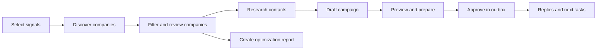

# Siveron — B2B Research & Outreach Workspace

Siveron combines company research, evidence-based signals, contact management,
AI-assisted analysis and controlled campaigns in a locally operated web interface.
The interface and integrated help support **German and English**.

**Product development and local extensions: Bao Dang.** Built on
[Harvey by Ethan Rogers](https://github.com/ethanplusai/harvey), v0.3.0
(`e2632eb`). The application and local modifications remain under the **MIT license**.
Third-party components retain their respective licenses.

[German manual](docs/HANDBUCH_DE.md) · [English user guide](docs/USER_GUIDE_EN.md) ·
[Architecture](docs/ARCHITECTURE.md) · [Roadmap](docs/ROADMAP.md) ·
[Authors](AUTHORS.md) · [Licenses](THIRD_PARTY.md)

## What the platform offers

| Area | Features |
| --- | --- |
| Today | Overview of companies, contacts, signals and pending decisions |
| Discover | Company search by keywords, location and radius; data source selection; preview; search limits; pausable searches and compact progress details |
| Data sources | Provider-based search including OpenStreetMap, optional API providers and local Google Maps browser search; availability and limits vary by source |
| Signals and audiences | Explicit activation of criteria; stored observations; cohorts and target profiles with “match”, “no match” and “unknown” |
| Companies | Filters, saved views, public email search, company profiles, sources and review information, individual and bulk actions, reversible removal |
| Contact research | Public websites, web search and profile clues; optional Hunter integration; search budgets and limits; traceable sources and explicit adoption of findings |
| Decision-makers and contacts | Research and review contact people; company and individual contacts; selection of known email addresses; notes, contact blocks and trash |
| Optimization reports | Company reports based on stored signals; open review points instead of invented findings; optional AI explanations of visibility, AI search and customer acquisition; Markdown and print/PDF |
| AI assistant | Natural-language search suggestions, usage guidance and analysis of existing data; configurable features, language, response length and conversation context |
| Campaigns | Drafts, rich-text messages, placeholders, attachments, follow-ups, templates and guided preparation |
| Outbox | Review, explicit approvals, sending readiness and scheduled sequences through configured email integrations |
| Conversations and sales | Campaign conversation view, sales opportunities, next tasks and explicit outcome assessment |
| Settings and help | Local integration management, usage, agent controls and detailed German/English workflow documentation |

## Typical workflow



The assistant can suggest search criteria and analyze stored data.
Accepting a search suggestion does not start a search or grant additional
permissions. Reports use stored evidence; a report is not a new, comprehensive
website audit.

## Run locally

The repository includes **no credentials, customer datasets or configured sender
identities**. The public development template is neutral: email and LinkedIn
are disabled, the sending limit is zero and approvals are required.

```bash
git clone https://github.com/nexdevn-dot/SIveron_Hervay2.0.git
cd SIveron_Hervay2.0
bash scripts/setup.sh
bash scripts/doctor.sh
bash scripts/dashboard.sh
```

Dashboard: **http://127.0.0.1:5555/**. Starting the dashboard alone does not
authorize launching campaigns or sending messages.
See [START_HERE_DE.md](START_HERE_DE.md) (German) for setup and the remaining
steps before live use. Python and the pinned Codex CLI are managed locally;
the global Codex installation remains unchanged.

```bash
bash scripts/test.sh -q
scripts/harvey status
scripts/codex --version
```

Technical package names and CLI paths continue to use `harvey` for compatibility.
The product interface is called Siveron.

## Configuration and AI

- `config/development.yaml`: public, neutral development template.
- `harvey.local.yaml`: private local configuration, excluded from version control.
- `.env`: private integration credentials, excluded from version control; `.env.example` contains empty fields.
- SQLite state, authentication files, exports and product knowledge remain local.
- AI access uses the existing Claude/Codex integration; it requires suitable access
  and is subject to its usage limits. External research and verification providers
  may incur additional costs.
- The pinned Codex version and its authentication/tool checks form part of the
  runtime boundaries. The assistant interface does not grant the model shell,
  file, network or MCP access.

## Architecture and development

Python backend with a FastAPI dashboard, SQLite persistence and a JavaScript/CSS
interface. Functional areas share companies, contacts and observations;
research findings are reviewed before being adopted as contacts.
Local browser research does not require a separately operated scraper service.
Optional API providers remain separate integrations.

| Entry point | Purpose |
| --- | --- |
| `harvey/dashboard.py` | Dashboard and HTTP endpoints |
| `harvey/state.py` | Database state and migrations |
| `harvey/collectors/` | Company, website, email and people research |
| `harvey/web/` | Interface, localized help and local browser bundles |
| `docs/modules/` | Functional documentation with code entry points |
| `tests/` | Automated Python tests |
| `tools/` | Frontend builds, help export and pre-publication checks |

Start with [docs/INDEX.md](docs/INDEX.md) and read only the relevant module.
The current state and original baseline are described separately in the
[development comparison](docs/DEVELOPMENT_STATUS_2026-10-20.md).
The [roadmap](docs/ROADMAP.md) contains proposals; it is not a promise of
already available features. The previous README remains as a
[historical reference](docs/UPSTREAM_README.md) and does not override local
runtime requirements.

## Limitations and responsible operation

Discovered email addresses are not automatically technically verified.
Missing evidence does not prove that an attribute is absent. Search coverage,
provider limits, CAPTCHAs and website access may limit results. There is no
guarantee of complete market coverage, deliverability, rankings or revenue.

Product training, sender identity, mailbox setup and lawful outreach must be
configured and reviewed for the specific use case. Automated tests using mocks
prove neither live model access nor email delivery. Existing approval
requirements, blocks and sending pauses must be respected before live operation.

## Publishing and security

See the [publishing guide](docs/PUBLISHING.md). Before uploading:

```bash
.venv/bin/python tools/release/check_private_data.py --history
```

The check compares publishable files and Git blobs against local credential
values and selected key formats. It does not print keys.
It does not replace a comprehensive manual review or an established secret scanner.
If credentials were previously published, revoke and replace them with the
provider; deleting them from the current files is not sufficient.

## Summary

Siveron is a locally operated B2B research and outreach workspace developed by
Bao Dang on top of Harvey by Ethan Rogers. It combines company discovery,
evidence-based signals, reviewed contact research, company reports, an optional AI
assistant and approval-based campaign workflows in a German/English dashboard.

Development defaults disable live sending. Configure your own identity, mailbox and
optional integrations locally. Never commit `.env`, local configuration, databases,
authentication files or customer exports. Read the [English user guide](docs/USER_GUIDE_EN.md),
[engineering index](docs/INDEX.md) and [license](LICENSE) before deployment.
