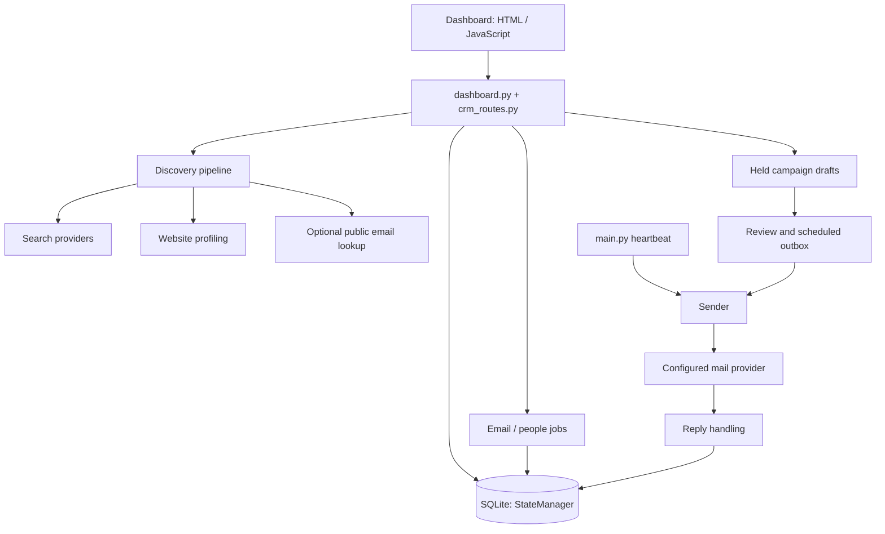

# Architecture

Code checked: 2026-10-18. Entry point: [index](INDEX.md).

## System shape

Local Python application with a FastAPI dashboard, SQLite persistence, and an
independent agent heartbeat. The web client is HTML/CSS and ordinary JavaScript,
with locally bundled editor, selection and location widgets. No frontend framework
or separately hosted scraping service is required by the current local Maps integration.

## Responsibilities

| Source | Responsibility |
| --- | --- |
| [dashboard.py](../harvey/dashboard.py) | Dashboard/API, discovery orchestration and agent controls |
| [crm_routes.py](../harvey/crm_routes.py), [crm.py](../harvey/crm.py) | Contact actions and held campaign drafts |
| [state.py](../harvey/state.py), [models/](../harvey/models/) | Persistence, migrations, records and lifecycle |
| [pipeline.py](../harvey/pipeline.py), [collectors/](../harvey/collectors/) | Discovery, observations, website/email/people collection |
| [main.py](../harvey/main.py), [agents/](../harvey/agents/) | Heartbeat, writing, analysis, sending and reply handling |
| [brain.py](../harvey/brain.py) | Model-provider boundary and Codex isolation/auth checks |
| [integrations/](../harvey/integrations/) | Mail, external enrichment and provider adapters |
| [web/](../harvey/web/) | App shell, feature UI, translations and help |

## Persistence and lifecycle boundaries

`companies` are organizations; `prospects` holds both named people and company
mailbox contacts. Finding an email does not itself create a contact.
`campaigns` holds sequence and membership data. `outbox` holds individual messages;
`conversations` stores exchanges. Signal definitions and observations are separate
from company/contact lifecycle status. Durable lookup jobs and their items have
separate tables; discovery progress is coordinated by `discovery_progress.py`.

SQLite migrations live in `state.py`. Append migrations; never rewrite a migration
already applied to user data. Read database operations through StateManager/feature
services rather than duplicating schema assumptions in UI code.

Dashboard startup does not itself start the sales heartbeat. Stopping discovery,
pausing delivery and stopping the heartbeat are different controls. Discovery
profiling can inspect a backlog of previously imported companies, not only the
latest search. Optional discovery email lookup is scoped to that search's IDs.

## Trust and side effects

Website text and model output are untrusted inputs. Collection is distinct from
contact acceptance, draft preparation, approval and actual delivery. Keep these
boundaries explicit. Do not weaken pinned Codex checks or test by sending live mail.
Private YAML, environment secrets, authentication, database and runtime files are
not documentation inputs. See [development](DEVELOPMENT.md) and [working rules](../AGENTS.md).

## Reuse boundaries

Reuse boundary review: 2026-10-23. The [component catalog](REUSABLE_COMPONENTS.md)
separates deterministic helpers from injected adapters and database/lifecycle-bound
workflows. Detailed diagrams describe current contracts; proposed extractions are
labelled explicitly. HTTP routes, UI scripts and SQLite migrations are application
boundaries, not interchangeable standalone packages.
