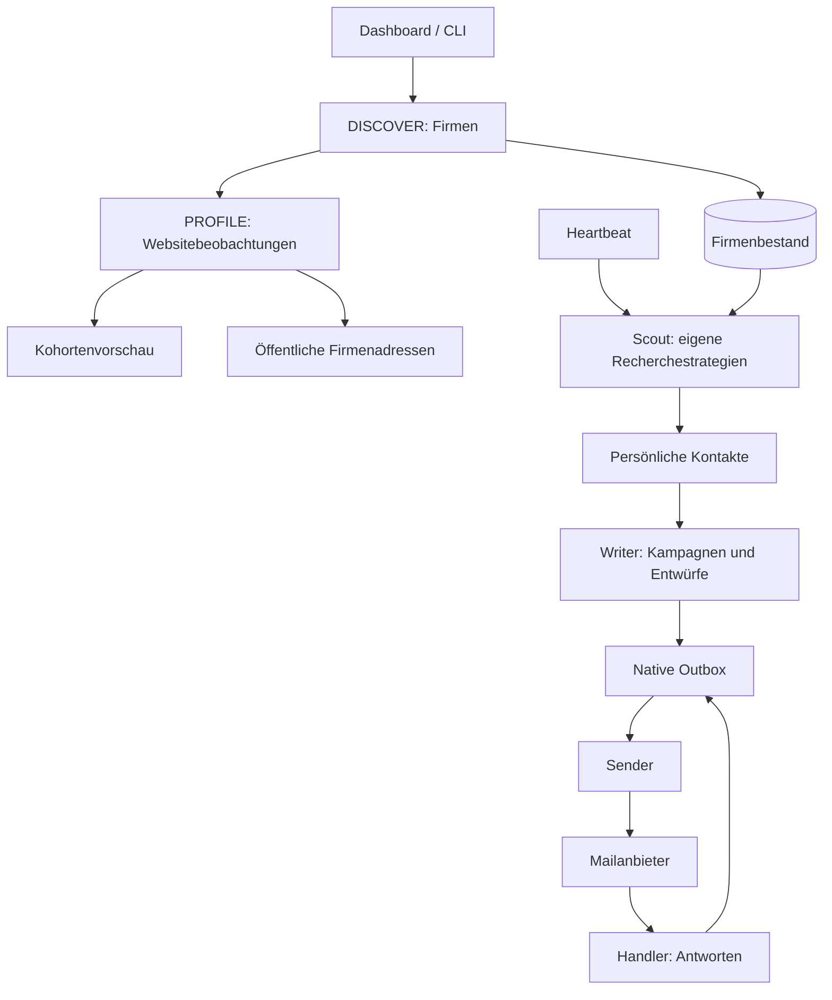

# Siveron – Entwicklungsstand und Reifegrad

Aktueller Vergleich vom 20.10.2026: [Weiterentwicklung durch Bao Dang auf Basis von
Harvey von Ethan Rogers](DEVELOPMENT_STATUS_2026-10-20.md). MIT bleibt erhalten.
Die nachfolgende historische Bewertung wird dadurch nicht rückwirkend geändert.

## Historische Bewertung – Nachtrag vom 18.10.2026

Der folgende ursprüngliche Befund beschreibt den Stand vom **16.10.2026**.
Seine Reifegrade und damaligen Lücken sind keine aktuelle Bewertung.
Seitdem wurden unter anderem manuelle Kampagnenvorbereitung mit Übergabe in den
Postausgang, Firmenkontakt-Unterstützung, vereinfachte manuelle E-Mail-Eignung,
Kontaktaktionen/Papierkorb, Composer/Anhänge, Kampagnen-Unterhaltungen sowie
Such-, Filter- und Fortschrittsfunktionen ergänzt beziehungsweise erweitert.

Den aktuellen implementierten Umfang dokumentieren [Modulübersichten](INDEX.md).
Noch nicht umgesetzte Vorschläge stehen separat in der [Roadmap](ROADMAP.md).
Dieser Nachtrag vergibt keinen neuen Gesamtreifegrad und behauptet keinen neuen
Live-Nachweis. Die ursprüngliche Bewertung bleibt zur Nachvollziehbarkeit erhalten.

---

Stand: 16. Oktober 2026. Untersucht wurde die lokale Arbeitskopie in `the local project checkout`, einschließlich der noch nicht committeten Änderungen. Basis ist Upstream 0.3.0, Commit `e2632eb20ee2d4fb6fe04ae715a52f578acf9a37`.

## 1. Gesamtbewertung

**Das Projekt ist ein umfangreich implementiertes MVP mit Teilen auf Beta-Niveau. Für einen zuverlässig unbeaufsichtigten Vertriebsbetrieb fehlen noch wesentliche Korrekturen und Nachweise.**

Die Firmenrecherche und Websiteanalyse sind bereits praktisch verwendet worden. Die gesamte anschließende Kette bis zur Antwortbearbeitung existiert im Code, hat in dieser Installation aber noch keine persönlichen Kontakte, Kampagnen oder versendeten Nachrichten hervorgebracht. Eine vorhandene Funktion und ein nachgewiesener Liveprozess sind daher getrennt zu bewerten.

Meine Einordnung des Gesamtprodukts lautet **Reifegrad 2 bis 3 von 5: funktionsfähiges MVP / frühe Beta**. Das ist eine technische Einschätzung, keine gemessene Fertigstellungsquote. Eine Aussage wie „80 Prozent fertig“ wäre ohne verbindlichen Zielumfang irreführend. Die im Dashboard ausgewiesenen 83 Prozent beziehen sich ausschließlich auf Einrichtungshäkchen.

Die nächste Entwicklungsphase sollte die vorhandene Kette zuverlässig schließen. Mehr Rechercheanbieter oder zusätzliche autonome Kanäle sind derzeit nachrangig.

## 2. Tatsächlicher lokaler Stand

Die bestehende Dokumentation beschreibt zum Teil noch eine neutrale, leere Umgebung. Der bei der Analyse vorgefundene Zustand ist inzwischen weiter:

| Merkmal | Ermittelter Zustand | Bedeutung |
|---|---:|---|
| Firmen | 196 | Recherche wurde bereits durchgeführt |
| Firmen mit Domain | 95 | Können grundsätzlich über ihre Website analysiert werden |
| Firmen ohne Domain | 101 | Websitebasierte Kontaktanreicherung greift hier nicht |
| Firmen mit hinterlegter Telefonnummer | 95 | Telefonnummern sind vorhanden, keine Telefonkampagne nachgewiesen |
| Firmen mit vermerktem Profilprüfversuch | 95 | Ein Versuch ist noch kein erfolgreicher Abruf |
| Beobachtungen | 918 | Technische Signale und Rechercheergebnisse sind gespeichert |
| Bestätigte Signale | 23 von 23 | Bereits vor der Analyse bestätigt; im Audit nicht geändert |
| Persönliche Kontakte / Prospects | 0 | Die Kontaktstufe ist der aktuelle fachliche Engpass |
| Gesondert gespeicherte öffentliche Firmen-E-Mail-Adressen | 0 | Auch dieser alternative Kontaktbestand ist leer |
| Kampagnen / Gespräche / Outbox-Nachrichten | jeweils 0 | Kein lokaler Nachweis der nachfolgenden Vertriebskette |
| Rechercheläufe | 5 als abgeschlossen gespeichert | Firmenquellen: 98 OSM, 98 Geoapify |
| Profilläufe | 2 als abgeschlossen gespeichert | Die Datenbank enthält Profilbeobachtungen für 89 Firmen |
| Mailanbieter | SMTP/IMAP | Zugangseinstellungen sind vorhanden; Verbindungsfunktion hier nicht live geprüft |
| E-Mail-Kanal | deaktiviert | Aktuell kein freigegebener Mailbetrieb |
| Tageslimit | 0 | Versand zusätzlich begrenzt |
| Versandfreigabe | erforderlich | Bestehende Einstellung erhalten |
| Globale Versandsperre | aktiv | Bestehende Sperre erhalten |
| LinkedIn-Kanal | deaktiviert | Kein freigegebener LinkedIn-Betrieb |
| Produktwissen und Geschäftskonfiguration | vorhanden | Inhaltliche Richtigkeit wurde nicht als Geschäftsanalyse bewertet |
| Verifikationsanbieter | nicht eingerichtet | Keine konfigurierten Reoon-, ZeroBounce- oder Hunter-Schlüssel festgestellt |
| Einrichtungsanzeige | 83 Prozent | Prüft weder Zustellbarkeit noch Produktionsreife |
| SQLite-Kurzprüfung | `ok`, Schema-Version 12 | Kein dabei erkennbarer Strukturfehler der lokalen Datenbank |

Es gibt einen gespeicherten KI-Nutzungseintrag. Das ist kein Nachweis für die vollständige Vertriebskette oder für eine aktuell funktionsfähige Anmeldung.

**Aktuelle Betriebsblockade:** `scripts/harvey status --check` meldet am 16. Oktober 2026 für `gpt-6-luna` eine abgelaufene beziehungsweise erneuerungsbedürftige Codex-CLI-Anmeldung und beendet sich mit Exitcode 1. Dabei wurde kein Modellprompt gesendet. Eine Anmeldung wurde im Audit weder erneuert noch umgestellt.

## 3. Reifegrade der einzelnen Bereiche

Skala: **1** = Entwurf/Platzhalter; **2** = teilweise belastbarer Prototyp; **3** = funktionales MVP/Beta mit Tests; **4** = für den vorgesehenen lokalen Einsatz gut abgesichert; **5** = unter realen Betriebsbedingungen nachgewiesen und betrieblich ausgereift. Kein Bereich erhält allein wegen vieler Codezeilen einen hohen Wert.

| Bereich | Reifegrad | Begründung |
|---|---:|---|
| Lokale Entwicklungsumgebung | 4/5 | Projektlokales Python, gepinnte Codex CLI, Lockdatei, Setup-, Diagnose- und Testskripte |
| Firmenrecherche | 3/5 | Sechs Adapter, Kosten-/Quotenlogik, gespeicherte Ergebnisse; externe Datenqualität und Abdeckung bleiben begrenzt |
| Websiteprofilierung | 3/5 | Viele Detektoren, Quellenbelege, Verlauf und Wiederholungsabfragen; Veraltung und negative Befunde nicht durchgängig gelöst |
| Kontaktanreicherung und Verifikation | 2/5 | Teamseiten, Hunter und Verifikatoren implementiert; lokaler Kontaktbestand weiterhin leer |
| KI-Anbindung und Isolation | 4/5 technisch | Umfangreiche Sicherheitsprüfungen und echte CLI-Tests; Liveanmeldung aktuell blockiert, Antwortqualität nicht evaluiert |
| Kampagnen und Personalisierung | 3/5 | Sequenzen, individuelle erste Mail, Vorlagen und Wissensdateien vorhanden; noch kein lokaler Realbetrieb |
| Versand und Freigaben | 2/5 | Gute native Grundstruktur, aber reproduzierte Lücken bei Fehlern, Parallelität und Legacy-Pfad |
| Eingang und Gesprächsführung | 2/5 | Klassifikation, Opt-out, Eskalation und Antwortentwürfe vorhanden; Zustell-/Verarbeitungsbestätigung unzuverlässig |
| Dashboard und CLI | 3/5 | Breite Verwaltungsoberfläche und funktionierende geprüfte API-Routen; begrenzte Bedienfunktionen und keine Mehrnutzerabsicherung |
| Kennzahlen und Rückkopplung | 2/5 | Berichte und Nutzungsdaten vorhanden; Kampagnenzuordnung und Berechnung teilweise fehlerhaft, Feedback nicht lernwirksam verdrahtet |
| Dauerbetrieb und Wiederherstellung | 2/5 | WAL, Migrationen, Timeouts, Backoff und Shutdown vorhanden; kein belastbarer Versand-Claim und kein geprüftes Backup-/Restore-Verfahren |
| Kalender / automatisches Buchen | 1/5 | Expliziter Platzhalter ohne Implementierung |

## 4. Was bereits entwickelt wurde

### Anwendung und Datenhaltung

- Python-Anwendung mit CLI und FastAPI-Dashboard; die Weboberfläche verwendet HTML, CSS und JavaScript ohne zusätzlichen Frontend-Build.
- SQLite-Datenmodell für Firmen, Personen, Beobachtungen, Signale, Kampagnen, Gespräche, Outbox, Aktionen, Nutzung, Feedback und Einstellungen.
- Zwölf aufeinanderfolgende Migrationen, WAL-Modus, Wartezeit bei Datenbanksperren, teilweise eindeutige Indizes zur Deduplizierung und atomare Reservierung bestimmter Recherchekontingente.
- Heartbeat mit Ruhezeiten, Budgetprüfung, deterministischer Aufgabenwahl, Fehler-Backoff und begrenzter Laufzeit von Agentenbatches.
- Fünf Anwendungsagenten: Scout, Writer, Sender, Handler und Analyst. Diese sind Komponenten des Produkts; das Audit hat keine zusätzlichen Codex-Unteragenten gestartet.

### Recherche und Signale

- Adapter für OpenStreetMap, Geoapify, SerpApi, DataForSEO Business Listings, DataForSEO SERP und Serper.
- Stadt-/Koordinatenauflösung, Schätzung vor einem Lauf, Ausgabenbegrenzung, Abbruchschalter und Speicherung je Recherchebatch.
- Zusätzliche lokale Tages-/Monatskontingente für Geoapify und SerpApi. SerpApi prüft außerdem Kontoinformationen; die lokalen Zähler kennen die Nutzung durch andere Anwendungen nicht.
- 23 Signale mit Bestätigungsstatus, Herkunft, Beobachtungszeit, Konfidenz und Quellen-URL.
- Websiteanalyse für Technik, Tracking-Tags, Buchungsmöglichkeiten, strukturierte Daten, Agenturhinweise, Sitemap, Inhaltsalter, Kontaktformulare, Stellen und Personen.
- SQL-basierte Kohorten mit erforderlichen und ausgeschlossenen Signalen. Diese sind bislang eine Vorschau, keine durchgängige Kampagnensteuerung.
- Separate Suche nach veröffentlichten Firmenadressen mit begrenzten Abrufen, Größenlimit sowie Host-/IP-Prüfung. Diese Adressen werden bewusst getrennt von persönlichen Kontakten gespeichert.

### Personen, Texte und Mail

- Recherche von Personen auf Teamseiten, aus Suchergebnissen und optional über LinkedIn beziehungsweise Hunter.
- Adressmuster, MX-Prüfung und die Qualitätsstufen `verified`, `risky`, `guess`, `invalid`; Adapter für mehrere Verifikationsdienste.
- Optionale Jobbörsenstrategie über `python-jobspy`; diese Zusatzabhängigkeit ist lokal nicht installiert und die Strategie wird deshalb übersprungen.
- Produkttraining durch Websiteabruf und KI-Extraktion von Produkt, Zielgruppe, Einwänden und Wettbewerbsinformationen. Das erzeugt Wissensdateien und Konfiguration; es ist kein Modell-Finetuning.
- Kampagnensequenzen, Vorlagen und individuelle erste Nachrichten für native Mailanbieter.
- Gmail-OAuth/API und SMTP/IMAP als native Transportwege; Instantly als älterer separater Pfad.
- Native Outbox mit Freigabe, Ablehnung, Versandtermin, Limit, Inhaltsprüfung und Statushistorie über Datenbankfelder/Aktionsprotokoll.
- Antwortklassifikation, Stopp nach Antwort, Opt-out, Eskalation, Bounce-Erkennung, globale Versandsperre und Antwortentwürfe.

### Bedienung und Qualitätssicherung

- Dashboard für Tagesaufgaben, Firmen, Kontakte, Signale, Recherche, Kohorten, Outbox, Kampagnen, Gespräche, Einstellungen und Nutzung.
- Deutsche/englische UI-Texte und lokale Schriftarten; Datumsformatierung und helle/dunkle Darstellung sind implementiert.
- CSV-Export persönlicher Kontakte mit Qualitätsfiltern. Eine Firmenliste ohne persönliche Kontakte ist damit noch kein versandfertiger Kontakteexport.
- Tests für Datenmodelle, Migrationen, Recherche, Adapter, Outbox, Providerwechsel, Codex-Isolation und ganze Heartbeat-Abläufe mit simulierten Außenstellen.
- CI-Konfiguration für Linux, macOS und Windows mit Python 3.11/3.12; Codex ist auf Windows ausdrücklich nicht unterstützt. Der aktuelle CI-Status auf einem entfernten Repository wurde nicht geprüft.

### Tatsächliche Architekturgrenze

Es bestehen zwei Recherchewege: Die neue DISCOVER/PROFILE-Pipeline arbeitet mit Beobachtungen und Signalen. Der ältere Scout recherchiert und reichert Kontakte über eigene Strategien an. Der Heartbeat ruft den Scout auf und verwendet dabei weder automatisch den im Dashboard gewählten Rechercheanbieter noch dessen Kohortenvorschau als verbindliche Auswahl.



Zwischen einer passenden Kohorte und einer ausschließlich daraus erstellten Kampagne fehlt ein verbindlicher, gespeicherter Auswahlprozess.

## 5. Bestätigte Entwicklungsfehler und Lücken

**P1** bedeutet hier: vor einem unbeaufsichtigten Versand beheben. **P2** bedeutet: für einen belastbaren Pilot- und Dauerbetrieb bearbeiten. Die Einstufung unterstellt keine aktuelle Versandfreigabe; die vorgefundenen lokalen Sperren bleiben wirksam.

### F01 – Mailabruf fehlgeschlagen, trotzdem „vollständig gelesen“ (P1)

Gmail gibt bei fehlgeschlagenen API-Abfragen `[]` zurück beziehungsweise überspringt einzelne fehlgeschlagene Nachrichtenabrufe. SMTP/IMAP fängt Abruffehler ab und gibt ebenfalls `[]` zurück. Der Handler interpretiert die leere Liste als erfolgreichen Abruf und liefert `True`. Damit kann die vorgesehene Sperre „erst Antworten lesen, dann senden“ ausfallen.

**Nachweis:** Mit der echten Gmail- beziehungsweise SMTP-Adapterlogik und simuliertem Abruffehler lieferte `Handler.run()` in beiden Fällen `True`.

**Erforderlich:** Abruffehler und unvollständige Seiten explizit melden, Versand bei unvollständiger Eingangssynchronisation halten. Tests an den echten Adaptergrenzen ergänzen; die bestehenden End-to-End-Tests werfen den Fehler aus einem Fake-Provider, während die realen Provider ihn teilweise verschlucken.

Quellen: [Gmail-Abruf](../harvey/integrations/gmail.py#L175), [SMTP-Abruf](../harvey/integrations/smtp_mail.py#L89), [Handler](../harvey/agents/handler.py#L368).

### F02 – Eingehende Antworten können beim Wiederholen verloren gehen (P1)

Der Handler markiert eine Nachricht bei allgemeinen Verarbeitungsfehlern im `finally`-Block als verarbeitet. Nur `BrainUnavailable` wird davon ausdrücklich ausgenommen. Ein Datenbankfehler kann deshalb die erneute Verarbeitung verhindern.

Zusätzlich liest der IMAP-Adapter mit `RFC822`; dies kann Nachrichten bereits beim Abruf als gelesen markieren. Ein späterer Modell- oder Verarbeitungsfehler lässt die Nachricht dann beim nächsten `UNSEEN`-Abruf fehlen. Gmail liest nur die erste begrenzte Liste der letzten sieben Tage ohne fortgeführten Cursor; ein größerer oder länger liegengebliebener Eingang ist damit nicht zuverlässig abgedeckt.

**Nachweis:** Simulierter Verarbeitungsfehler → Handler meldet zwar `False`, die Nachricht ist anschließend aber als verarbeitet gespeichert. Die IMAP-Abrufreihenfolge und Gmail-Begrenzung wurden im Code festgestellt, nicht an einem echten Postfach getestet.

**Erforderlich:** Dauerhaftes Eingangsjournal, stabile IDs/Cursor, Abruf ohne vorzeitige Gelesen-Markierung und Quittierung erst nach erfolgreicher Verarbeitung; fehlgeschlagene Nachrichten erneut verarbeiten oder zur manuellen Klärung ablegen.

Quelle: [Eingangsverarbeitung](../harvey/agents/handler.py#L368), [IMAP-Implementierung](../harvey/integrations/smtp_mail.py#L97).

### F03 – Instantly umgeht wesentliche native Versandkontrollen (P1)

Der Legacy-Pfad aktiviert Kampagnen ohne dieselbe Outbox-Freigabe, globale Versandsperre und deterministische Inhaltsprüfung wie Gmail/SMTP. Legacy-Antworten können ebenfalls unmittelbar gesendet werden. `require_approval: true` ist daher kein einheitlicher Schutz über alle Anbieter.

**Nachweis:** Eine synthetische Kampagne mit aktiver Versandsperre, erforderlicher Freigabe und eigentlich gesperrtem Inhalt wurde beim simulierten Instantly-Adapter aktiviert. Es entstanden null Outbox-Einträge. Keine echte Instantly-Anfrage wurde gesendet.

**Erforderlich:** Gemeinsame Versandpolitik vor jedem Transport oder Legacy-Pfad bis dahin explizit sperren. Mailanbieter als erlaubte Auswahl validieren; unbekannte Werte dürfen nicht in den Legacy-Pfad fallen.

Quellen: [Sender-Auswahl](../harvey/agents/sender.py#L75), [direkte Legacy-Antwort](../harvey/agents/handler.py#L345).

### F04 – Doppelversand bei parallelen Sendern; unklarer Zustand nach Absturz (P1)

Outbox-Nachrichten werden gelesen, versendet und anschließend auf `sent` gesetzt. Ein atomarer Übergang von `approved` nach `sending` mit exklusivem Claim fehlt. Zwei Sender können dieselbe Zeile versenden. Auch das Fenster „Mail angenommen, Prozess vor Datenbankspeicherung abgestürzt“ wird nicht zuverlässig aufgelöst. Der eindeutige Index verhindert doppelte Anlage, aber keinen doppelten Versand derselben Zeile.

**Nachweis:** Zwei gleichzeitig ausgeführte Sender haben eine einzige freigegebene Outbox-Zeile zweimal an den lokalen Fake-Transport übergeben.

**Erforderlich:** Atomarer Claim/Lease, eine wirksame Einzelinstanzsperre, stabile Versandidentität und Wiederanlauf mit Abgleich unklarer Zustände. Bei Transporten ohne Idempotenzgarantie darf ein unklarer Ausgang nicht blind erneut gesendet werden.

Quellen: [Versandschleife](../harvey/agents/sender.py#L420), [Outbox-Lesen](../harvey/state.py#L870).

### F05 – Eine während des Versandblocks gesetzte Pause greift zu spät (P1)

Der native Sender prüft die globale Versandsperre vor dem Block, aber nicht erneut vor jeder Nachricht. Auch der Freigabestatus einer bereits geladenen Zeile wird vor dem tatsächlichen Versand nicht nochmals aus der Datenbank gelesen.

**Nachweis:** Der Fake-Transport setzte nach der ersten Nachricht die Pause. Trotzdem wurden zwei von zwei Nachrichten versendet.

**Erforderlich:** Pause und aktuellen Nachrichtenstatus unmittelbar vor jedem Versand prüfen und in das Claim-Verfahren einbeziehen. Eine bereits beim Transport befindliche Nachricht kann dadurch nicht zurückgerufen werden; weitere dürfen nicht neu begonnen werden.

Quelle: [native Verarbeitung](../harvey/agents/sender.py#L316).

### F06 – Erneutes Produkttraining ersetzt Sicherheits- und Kanalvorgaben (P1)

Der Trainer erhält die gewählte KI-Konfiguration, baut die übrige Konfiguration jedoch neu auf und überschreibt die Ausgabedatei. Dabei setzt er E-Mail auf aktiv, Anbieter auf Instantly, Tageslimit auf 50 und LinkedIn auf aktiv. Andere bestehende Einstellungen wie die lokale Zeitzone und besondere Suchvorgaben werden ebenfalls nicht durchgängig übernommen. Zudem erzeugt er eine Absenderadresse aus dem Domainnamen, ohne deren Existenz zu prüfen.

**Nachweis:** Der Konfigurationsgenerator erzeugte mit reinen Testdaten exakt diese aktiven Kanäle und das Limit 50. Der Dateischreibpfad wurde im Code geprüft. Die aktive Konfiguration wurde nicht überschrieben.

**Erforderlich:** Produkttraining auf Produkt-/Wissensänderungen begrenzen, vorhandene Betriebsregeln erhalten und Änderungen vor Übernahme als Differenz zeigen. Absender nicht automatisch als geprüft behandeln. Eine vorhandene Datenbankpause wird durch Training nicht entfernt, schützt aber den Legacy-Pfad gemäß F03 nicht gleichwertig.

Quellen: [Training und Dateischreiben](../harvey/trainer.py#L337), [Konfigurationsgenerator](../harvey/trainer.py#L724).

### F07 – Aufgabenwahl kann ohne Fortschritt hängen bleiben (P1)

Schon ein einziger `new`-Kontakt führt zu `write_campaign`. Hat er keine zustellbare Adresse, überspringt der Writer ihn; sein Status bleibt `new`, und der nächste Zyklus wählt erneut dieselbe erfolglose Aufgabe. Offene Gespräche haben zudem dauerhaft Vorrang, auch wenn gerade keine neue Nachricht vorliegt. Der `idle`-Zweig ist bei normalen nichtnegativen Kontaktzahlen logisch unerreichbar: Jede positive Zahl wird vorher abgefangen, null erfüllt anschließend `< 20`.

**Nachweis:** Ein einziger Kontakt mit Adressstatus `guess` → `write_campaign`, keine Kampagne nach Writer-Lauf, anschließend wieder `write_campaign`.

**Erforderlich:** Arbeitsfähige Aufgaben statt bloßer Bestandszahlen zählen; Adressanreicherung, wartende Gespräche, neue Antworten und blockierte Kontakte getrennt behandeln. Mehrere fällige Arbeitsarten fair ausführen und Fortschritt messen.

Quellen: [Aufgabenwahl](../harvey/main.py#L76), [Writer-Filter](../harvey/agents/writer.py#L47).

### F08 – Signalbestätigung und Kohortenauswahl sind nicht durchgängig verbindlich (P1)

DISCOVER/PROFILE beachten den Bestätigungsstatus für Beobachtungen. Der Scout verwendet daneben eigene Recherche- und Signalwege, ohne dieselbe Auswahl verbindlich abzufragen. Er kann Technik- und Einstellungsinformationen unmittelbar im Firmenmodell speichern. Die im Dashboard erzeugte Kohorte wird nur angezeigt; Writer und Scout verwenden sie nicht als verpflichtende Kampagnengrenze.

**Nachweis:** Bei null bestätigten Signalen speicherte der Scout in einer isolierten Simulation je einen Technik- und Einstellungsbefund. Für den fehlenden Kohortenübergang wurden Aufrufstellen und Datenfluss geprüft.

**Erforderlich:** Gemeinsame Recherchepolitik, verpflichtende Bestätigungsprüfung auch im Scout und gespeicherte Zielgruppen-/Kampagnenmitgliedschaft. Recherchequelle, erlaubte Signale und Zielauswahl müssen in allen Einstiegspunkten dieselbe Bedeutung haben.

Quellen: [Scout-Strategien](../harvey/agents/scout.py#L120), [Scout-Signalanreicherung](../harvey/agents/scout.py#L1594), [Kohortenvorschau](../harvey/dashboard.py#L1399).

### F09 – Native Antworten fehlen in der Kampagnenstatistik (P2)

Native Antworten werden über den Absender einer Person zugeordnet, aber eine neu angelegte Unterhaltung erhält dabei keine aufgelöste Kampagnen-ID. Die Kampagnenstatistik verbindet über genau diese ID und kann Antworten deshalb nicht zählen. Daneben verwendet der Analyst teils aktuelle, gegenseitig ausschließende Personenstatus als Nenner einer Antwortrate; dieser Nenner schrumpft, wenn Personen von `contacted` nach `replied` wechseln.

**Nachweis:** Eine simulierte Antwort auf eine aktive native Kampagne erzeugte eine Unterhaltung mit leerer Kampagnen-ID; die Kampagnenstatistik blieb bei null Antworten. Das Nennerproblem ergibt sich aus der Berechnung und den Statusübergängen.

**Erforderlich:** Zuordnung über Versand-/Thread-IDs, beständige Versand- und Antwortereignisse, definierte Zähler/Nenner und Tests für vollständige Personenverläufe. Geschäftliche Erfolgskennzahlen brauchen bestätigte Termine beziehungsweise Abschlüsse; Vertriebsstufen allein belegen diese nicht.

Quellen: [Gesprächsanlage](../harvey/agents/handler.py#L240), [Kampagnenstatistik](../harvey/state.py#L1641), [Analyst](../harvey/agents/analyst.py#L22).

### F10 – Wiederholte Beobachtung ersetzt verschwundene Textsignale nicht (P2)

Ein positiver Agenturhinweis wird gespeichert. Wird bei einem späteren Profilabruf keine Agentur mehr gefunden, entsteht dafür kein negativer beziehungsweise aufhebender Befund. Die Kohorte kann daher weiterhin den alten Hinweis verwenden. Ein erneuter Abruf nach 90 Tagen löst dieses Problem allein nicht.

**Nachweis:** Ein künstlicher Agenturhinweis von 2020 blieb nach einem neuen Abruf ohne Agenturhinweis Bestandteil der passenden Kohorte.

**Erforderlich:** Unterscheiden zwischen „vorhanden“, „geprüft und nicht vorhanden“, „nicht prüfbar“ und „veraltet“. Gültigkeitsfristen sowie definierte Regeln für mehrwertige Signale und Änderungen einführen.

Quellen: [Profilbefunde](../harvey/collectors/profile.py#L343), [aktuelle Kohortenansicht](../harvey/state.py#L1149).

### Weitere technische Grenzen, aus Codeprüfung abgeleitet (P2 / abhängig vom Zielbetrieb)

- **Lokales Dashboard:** Keine Anwendungsanmeldung, Rollen oder Hostprüfung festgestellt. Ein ASGI-Aufruf mit fremdem Host wurde akzeptiert. Standardmäßig bindet es an `127.0.0.1`; damit ist kein aktueller öffentlicher Zugriff nachgewiesen. Eine Netzwerkfreigabe braucht ein eigenes Schutzkonzept und Prüfung der schreibenden Routen.
- **HTTP-Abrufe:** Die neue explizite Kontaktsuche prüft öffentliche Zieladressen und Redirects. Die älteren Profiler-/Scout-/Trainerwege haben keine gleichwertige gemeinsame Prüfung. Interne Netzwerkziele, Redirects und Größenlimits sollten zentral behandelt werden. Ein vollständiger Angriffstest wurde nicht durchgeführt.
- **Wiederholungsversuche:** Fehlgeschlagene native Sendungen wechseln auf `failed`; eine differenzierte Wiederholung vorübergehender Fehler und Klärung ungewisser Ausgänge fehlt.
- **Ruhezeiten und Limits:** Kontrollen finden überwiegend am Zyklusbeginn statt. Lang laufende Arbeit, Tageswechsel und verschiedene Zeitbasen müssen mitgezählt und vor Versand erneut geprüft werden. Tageszählungen verwenden nicht durchgängig die konfigurierte Geschäftszeitzone.
- **Dashboard-Einrichtung:** SMTP gilt aufgrund vorhandener Felder als eingerichtet. Das beweist keine funktionierende IMAP-/SMTP-Verbindung. Die 83-Prozent-Anzeige berücksichtigt die aktuell blockierte Codex-Anmeldung nicht als eigenen Pflichtpunkt.
- **Listen und Fehlerbilder:** Mehrere Endpunkte begrenzen Ergebnisse auf feste Obergrenzen statt Pagination; Datenbankfehler werden teilweise als leere Listen zurückgegeben. Das kann bei mehr Daten oder Fehlern einen irreführend leeren Bestand zeigen.
- **Wissensqualität:** Wettbewerbsaussagen dürfen vom Trainer ausdrücklich inferiert werden. Extrahierte Tatsachen, Vermutungen und manuell freigegebene Aussagen sind nicht sauber getrennt. Tracking-Code ist zudem nur ein technischer Hinweis, kein Beleg für aktuell laufende Werbeausgaben.
- **Feedback:** Kommentare können gespeichert und gelesen werden; im untersuchten Code wird dieses Feedback nicht automatisch in Scout-, Writer- oder Handlerentscheidungen eingespeist. Selbstständiges Lernen ist damit nicht nachgewiesen.
- **Betriebsführung:** Kein im Projekt implementierter und geprüfter Backup-/Restore-Ablauf, keine Ende-zu-Ende-Wiederherstellungsprobe und kein vollständiges Alarmsystem festgestellt. Der Docker-Healthcheck nutzt das Datenbank-Dateialter; das unterscheidet gesunden Leerlauf und einen gestörten Prozess nicht zuverlässig.

## 6. Was noch entwickelt werden muss – und was nur einzurichten ist

| Thema | Art der offenen Arbeit | Konkret |
|---|---|---|
| Codex-Anmeldung | Einrichtung | Vorhandene CLI-Anmeldung durch den Eigentümer erneuern und Vorabcheck wiederholen; keine neue Modellintegration nötig |
| Mailzugang | Einrichtung + Nachweis | Einstellungen existieren; Abruf und Versand zunächst gegen kontrollierte Testpostfächer nachweisen |
| Adressverifikation | Einrichtung | Vorhandenen Adapter konfigurieren; das allein erzeugt noch keine Personen oder Adressen |
| Produktwissen | Fachliche Prüfung | Bereits vorhanden; Tatsachen, Angebot, Absender und Ton durch den Eigentümer prüfen |
| Firmen → erreichbare Kontakte | Entwicklung + Datenqualität | Website-/Teamseitenwege diagnostizierbar machen, Gründe für null Kontakte anzeigen, Rollenadressen getrennt behandeln, Firmen ohne Website sinnvoll bearbeiten |
| Verbindliche Zielauswahl | Entwicklung | Kohorten speichern, Kontaktanreicherung und Kampagnen ausschließlich auf die freigegebene Auswahl begrenzen |
| Zuverlässiger Versand und Eingang | Fehlerbehebung | F01–F08 und Wiederanlaufverhalten schließen |
| Vollständige Kampagnenverwaltung | Entwicklung | Entwürfe gezielt bearbeiten, einzelne Sequenzen pausieren, abschließen und kontrolliert wiederaufnehmen; Lebenszyklus und Zustände vereinheitlichen |
| Terminbuchung | Neue Funktion | Echter Kalenderadapter, Slots, Zeitzonen, Konflikte, bestätigte Buchung und Rückmeldung in der Pipeline |
| Manuelle Übernahme | Entwicklung | Eskalierte Vorgänge im Dashboard vollständig bearbeiten, zuweisen, beantworten und abschließen |
| Kennzahlen | Fehlerbehebung + Produktdefinition | Native Antworten zuordnen, Versandereignisse verwenden, Termine und Abschlüsse explizit bestätigen |
| Datenpflege | Entwicklung | Lösch-/Aufbewahrungsabläufe, Korrekturen, Sperrlisten und nachvollziehbare Änderungen über den gesamten Datenbestand |
| Betriebssicherheit | Entwicklung + Betrieb | Einzelinstanz, Backup/Restore, Überwachung, Wiederholungsregeln und Upgradeprüfung |
| Qualitätsnachweise | Qualitätssicherung | Beschriftete deutsche Testfälle für Erkennung, Klassifikation, Personalisierung und Faktenbindung; keine ungetesteten Erfolgsversprechen |

**Optionaler Ausbau nach dem stabilen Kern:** Registeranreicherung, zusätzliche Datenquellen, echte durchgängige LinkedIn-Ansprache, Änderungsereignisse aus wiederholter Beobachtung und mehrere Produkte. Für LinkedIn sind Suche und Profilabruf implementiert; Verbindungsanfragen und Nachrichtenversand sind keine bereits vollständige Funktion dieser Integration. Mehrbenutzer-/Mandantenfähigkeit oder ein gehostetes SaaS wären ein eigener Zielumfang und sind für den heutigen lokalen Einsatz nicht automatisch erforderlich.

## 7. Priorisierter Entwicklungsplan mit Abnahmekriterien

### Phase A – Kontrollmechanismen und Datenverluste schließen

F01–F06 beheben: einheitliche Versandpolitik, zuverlässiger Eingang, atomare Verarbeitung, Pause vor jedem Versand und Training ohne Aktivierung von Kanälen.

**Abnahme:** Ein simuliertes Mailboxproblem verhindert jeden weiteren Versand; Verarbeitungsfehler werden erneut aufgenommen; parallele Sender erzeugen keine doppelte Übergabe; eine Pause stoppt den nächsten noch nicht begonnenen Versand; kein Anbieter umgeht die Freigabe; Produkttraining erhält deaktivierte Kanäle, Limit 0 und Providerwahl.

### Phase B – Einen ausgewählten Recherchebestand bis zum Entwurf führen

Aufgabenwahl korrigieren, Signalregeln vereinheitlichen und einen verbindlichen Übergang von Firmen/Kohorten zu Kontakten und Kampagnen bauen. Für jeden erfolglosen Kontaktversuch einen nachvollziehbaren Grund anzeigen. Zunächst einen kleinen, ausdrücklich ausgewählten Teilbestand verwenden; keine zusätzlichen Kampagnen im Rahmen dieses Audits starten.

**Abnahme:** Die ausgewählten Firmen gelangen zu geprüften Personen/Adressen oder zu einer erklärten Sperre; ein Kontakt ohne Adresse blockiert andere Aufgaben nicht; ausgeschlossene Firmen erscheinen in keiner Kampagne; alle Entwürfe bleiben im freizugebenden Zustand.

### Phase C – Kontrollierten Ende-zu-Ende-Pilot nachweisen

Mit eigens dafür bestimmten Testpostfächern die komplette Kette prüfen: Entwurf, Freigabe, Versand, Antwort, Opt-out, Bounce, Eskalation, Wiederanlauf und Ausfall des KI-Anbieters. Produktwissen und Ausgabequalität mit deutschen Beispielen prüfen. F09/F10 schließen und Kennzahlen anhand der Ereignisse abgleichen.

**Abnahme:** Genau eine Nachricht je freigegebenem Schritt; keine Fortsetzung nach Opt-out; Antworten bleiben bei Fehlern erhalten; Statistiken stimmen mit den Testereignissen überein; keine erfundenen Tatsachen in freigegebenen Texten.

### Phase D – Dauerbetrieb vorbereiten

Backup/Restore, Alarme, sichere Updates, ausreichend aussagekräftige Gesundheitsprüfung, Konfigurationshistorie und dokumentierte Betriebsabläufe ergänzen. Die Bereitstellung bleibt auf den tatsächlich vorgesehenen lokalen Einsatz zugeschnitten.

**Abnahme:** Wiederherstellung einer Kopie aus Backup ist erfolgreich; Ausfälle und blockierte Arbeit werden sichtbar; ein Upgrade erhält Konfiguration und Daten; ein Neustart führt weder zu verlorenem Eingang noch zu Doppelversand.

### Phase E – Funktionsausbau anhand des Nutzens

Erst danach Kalenderbuchung, weitere Kanäle oder mehrere Produkte ergänzen. Jede Erweiterung braucht einen vollständigen Ablauf mit beobachtbarem Ergebnis. Das bloße Anlegen eines Adapters oder Statuswerts reicht nicht als Fertigstellungsnachweis.

Eine belastbare Aufwandsschätzung sollte nach Festlegung des Pilotumfangs und der ersten Korrekturen erfolgen. Insbesondere Transportsicherheit und Kontaktqualität lassen sich aus der Anzahl vorhandener Dateien nicht seriös in Resttage übersetzen.

## 8. Durchgeführte Prüfungen und Grenzen

| Prüfung | Ergebnis |
|---|---|
| `bash scripts/test.sh -q` | 470 bestanden, 21 übersprungen; 15 Warnungen; Laufzeit rund 53 Sekunden |
| Zusätzliche Auswahl mit `HARVEY_CODEX_CLI_TESTS=1 HARVEY_PACKAGE_TESTS=1` | 29 bestanden, 1 übersprungen; rund 18 Sekunden. Diese Auswahl überschneidet sich mit der Standardsuite, Zahlen nicht addieren |
| Echte projektlokale Codex CLI gegen lokale Modell-/Angreifer-Mocks | Erfolgreich, einschließlich eingeschränktem Textmodus, Werkzeugabbruch und Isolation; keine echten Modellprompts oder Anmeldedaten verwendet |
| Optionaler Wheel-/Pakettest | Weiterhin übersprungen, weil `setuptools` in der lokalen Testumgebung fehlt; kein Paketinstallationsnachweis aus diesem Audit |
| `bash scripts/doctor.sh` | Python 3.12.15, Codex CLI 0.159.3 und gültige Konfiguration bestätigt; Kanäle aus, Limit 0, Versand pausiert |
| `scripts/harvey status --check` am 16.10.2026 | Nicht bereit: CLI-Anmeldung abgelaufen/erneuerungsbedürftig; kein Modellprompt |
| JavaScript-/Shell-Syntax | `node --check` für `app.js`/`i18n.js` und `bash -n` für die Projektskripte erfolgreich |
| Dashboard-/API-Rauchprüfung | 15 Routen einschließlich HTML/Assets, Firmen, Signalen, Outbox und CSV mit HTTP 200, ohne gemeldeten Anwendungsfehler; auf temporärer Datenbankkopie |
| Zusätzliche Fehlersimulationen | F01–F10 lokal reproduziert beziehungsweise mit ausdrücklich benannten ergänzenden Codebefunden abgegrenzt |
| SQLite-Kurzprüfung | `PRAGMA quick_check` = `ok`; keine vollständige fachliche Konsistenzprüfung |

Die erste Ausführung der optionalen CLI-Tests war durch gesperrte lokale Serverports in der Sandbox blockiert. Nach erlaubter Ausführung außerhalb dieser Beschränkung bestand die Testauswahl. Das war eine Umgebungsbeschränkung und kein bestätigter Anwendungsfehler.

Die Warnungen betreffen die FastAPI/Starlette-Testclient-Abhängigkeit und `datetime.utcnow()` im Analysten. Sie sind Wartungsbedarf, keine fehlgeschlagenen Tests.

**Nicht als geprüft behauptet:** echte Zustellung und Mailboxabruf, reale Modellantworten unter der aktuellen Anmeldung, Qualität der Firmen-/Personenextraktion gegenüber einer beschrifteten Referenzmenge, reale Terminbuchung, mehrtägiger Betrieb, Belastbarkeit bei großen Datenmengen, vollständige Sicherheitsprüfung oder rechtliche Eignung konkreter Kampagnen. Eine neue visuelle Browserprüfung konnte am zunächst nicht laufenden Dashboard nicht durchgeführt werden; HTML/Assets und API wurden anschließend in-process geprüft. Daraus folgt kein Nachweis für responsive Darstellung oder alle UI-Interaktionen.

Es wurde kein Vertriebsagent gestartet, kein Signal bestätigt, keine Recherche ausgeführt, kein Produkttraining mit echten Daten durchgeführt, keine Nachricht freigegeben oder versendet und kein Push vorgenommen. Anwendungscode und aktive Konfiguration blieben im Audit unverändert. Diagnosebefehle können ihren normalen Gesundheitsstatus speichern. Die neue Dokumentation und die synthetischen Reproduktionsdateien sind die Arbeitsergebnisse dieser Analyse.

## 9. Versionsstand und Dokumentationspflege

Vor Erstellung dieses Berichts enthielt die Arbeitskopie **62 veränderte versionierte Dateien und 12 unversionierte Einträge**; manche Einträge sind ganze Verzeichnisse. Der kurze Diff dieser versionierten Änderungen umfasst 1.827 hinzugefügte und 639 entfernte Zeilen. Unversionierte Ergänzungen sind darin nicht enthalten.

Das ist ein substanzieller lokaler Entwicklungsstand. Ein aktueller Klon des Upstream-Commits bildet diese Änderungen nicht automatisch ab. Neue Module, Tests, Skripte und UI-Übersetzungen müssen gemeinsam geprüft und versioniert werden; Zugangsdaten, private Wissensdateien, Datenbank und Laufzeiten bleiben ausgeschlossen.

Konkrete Dokumentationsabweichungen:

- `START_HERE_DE.md` nennt noch einen Ordner `Siveron`, während der untersuchte Checkout `Harvey` heißt.
- Die dort dokumentierten 0 Firmen, 0 bestätigten Signale, 33 Prozent Einrichtung und 455 Tests sind gegenüber dem aktuellen lokalen Stand veraltet.
- Die README nennt am Ende noch Release 0.2.1, während Paketmetadaten und Changelog 0.3.0 ausweisen.
- „Kalenderintegration“ ist weiterhin ein Platzhalter; vorhandene Vertriebsstufen sind keine nachgewiesene Buchungsfunktion.
- Die allgemeinen Aussagen über Freigaben und „nur bestätigte Signale“ müssen bis zur Vereinheitlichung der Codepfade präzisiert werden.
- Docker/Compose sind auf den Claude-Weg ausgerichtet; der lokale gepinnte Codex-Aufbau und `harvey.local.yaml` sind dort nicht entsprechend integriert. Ein Dockerbetrieb dieser lokalen Konfiguration wurde nicht validiert.

Diese Punkte sollten zusammen mit den funktionalen Korrekturen dokumentiert werden, statt lediglich die Einrichtungsanzeige auf 100 Prozent zu bringen.

## 10. Reproduktionsmaterial

- [Diagnoseskript mit ausschließlich synthetischen Daten](../docs/audit-2026-10-16/reproduce_findings.py)
- [Gespeicherte Ergebnisse der Simulationen](../docs/audit-2026-10-16/probe-results.json)

Ausführung aus dem Projektordner:

```bash
.venv/bin/python docs/audit-2026-10-16/reproduce_findings.py
```

Das Skript arbeitet mit temporären Datenbanken und Fake-Transporten, sendet keine Nachrichten und ruft kein Modell oder Rechercheportal auf. Seine JSON-Ausgabe dokumentiert beobachtetes Verhalten. Exitcode 0 bedeutet nur, dass die Reproduktion durchgelaufen ist; die darin gezeigten Fehler sind dadurch nicht behoben. Die Diagnose ersetzt keine späteren Regressionstests der Korrekturen.
