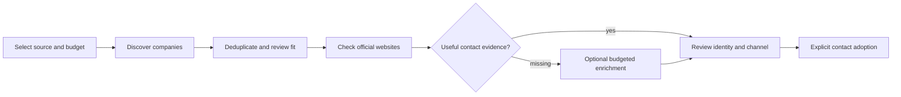

# Low-cost company and contact research

Code and official provider references checked: **2026-10-23**. Prices are a dated
USD reference, not a live quote. Tax, account eligibility, credit expiry and billing
conditions may change. Check the linked provider pages before purchasing.

This guide describes research choices, not permission to start a search, buy credits
or contact prospects. Development defaults remain unchanged. Examples are planning
scenarios, not measured yields or automatic budget presets in Siveron.

## Optimize for usable results

Distinguish a **discovered company**, a **company matching your criteria**, and a
**reviewed company with a usable contact channel**. A thousand listings are not a
thousand qualified leads. A named decision-maker, a general company mailbox and a
telephone number serve different purposes; count them separately.

The recommended sequence is: find companies inexpensively, deduplicate and review
fit, inspect official websites, then spend enrichment credits only on selected gaps.
No single source is guaranteed to cover every business or supply current contacts.

## Sources: what Siveron actually imports

Fields below are available only when the source supplies them and the current
adapter can read them. They are not completeness guarantees. Listing ratings and
phone numbers are source observations, not proof of quality or ownership.

| Route / provider key | Cost and access model | Current imported data | Main limitation |
| --- | --- | --- | --- |
| OpenStreetMap (`osm`) | No paid search account/API key for the current route; public-service/network limits apply | Name, location/category and available website, phone and published email tags | Uneven coverage and contact completeness; usage/attribution requirements still apply |
| Google Maps local (`google_maps`) | No search API key or separate paid search service; local Playwright/Chromium | Listing name, address, category, available website, phone, rating and Maps provenance | Experimental page parsing; no email or named-person result from this adapter; coverage and blocking limits |
| Geoapify Places (`geoapify`) | Own API key; Siveron's adapter is intended for the free-tier route | Name, address/location, category and available website/phone/email from contact/OSM properties | OSM-derived, not an independent company database; only mapped search categories supported |
| SerpApi web search (`serpapi`) | Own verified Free account; paid/unknown plans blocked by this adapter | Search title, website/domain, rank and source link | Organic website results, not a complete Maps listing or contact dataset |
| DataForSEO Business Listings (`dataforseo_listings`) | Own credentials; paid per task plus returned item | Name, address/location, category, domain/site, phone, rating/count and claimed flag where supplied | Current adapter does not import email or named decision-makers; website research follows |
| DataForSEO SERP (`dataforseo_serp`) / Serper (`serper`) | Own credentials; endpoint/plan-dependent usage charges or credits | Organic business-site search results and rank/provenance | Search results are candidate websites; direct company contact fields need later research |
| Official website research | No enrichment-provider fee for direct HTTP reads; local/network time applies | Explicitly published email/phone/address, person/role candidates and sources where found | Missing pages, ambiguous association and stale content; extraction is not verification |
| Optional Hunter contact lookup | Own key and enabled source with local budget | Published-result email suggestion for an existing named contact/domain | Suggestion is not automatically an accepted or verified Siveron contact |

### Google Maps local: useful, but not zero-cost in every sense

This is Siveron's local browser integration, **not the official Google Places API**.
There is no search API fee on this route, but machine time, bandwidth, maintenance
and review have costs. Quick/grid modes and checkpoints support bounded local work;
current limits include 100 sections and 200 listings per section. Exact-radius
checks skip records without usable coordinates. Login/CAPTCHA/blocking is not bypassed.
Google Maps terms apply; access through a browser does not establish unrestricted
reuse rights. No market-completeness or guaranteed-contact claim is made.

For a small local sample, start with quick mode and review coverage. Grid mode can
cover more sections but adds browser work and duplicates; it is not automatically
the cheapest route per useful contact. A listing with no website does not prove
that the company has no website elsewhere.

### Source overlap and missing websites

Geoapify and OSM overlap because Geoapify uses OSM-derived data. Do not count their
union as two independent coverage checks. Maps and paid listings can also overlap.
Review identity, source and duplicate records before counting new companies.
Organic website search naturally misses businesses with no indexed website. A
business without a usable website may need a different published contact source;
Siveron must not invent an address or attach an unrelated person's email.

## Dated provider offers versus integration limits

| Provider | Official offer checked on 2026-10-23 | What the integration does |
| --- | --- | --- |
| Geoapify | Free allowance: 3,000 credits/day. [Pricing](https://www.geoapify.com/pricing/) | Local reservation cap: 3,000 units per UTC day; requested result limit determines reservation units. This is not a provider-account billing audit |
| SerpApi | Free allowance: 250 searches/month; Starter offer: $25/month for 1,000 searches. [Pricing](https://serpapi.com/pricing) | Current discovery adapter accepts only a verified Free plan and caps local use at 250 per UTC month; the advertised paid plan is **not supported by this adapter** |
| Hunter | Free plan lists 50 shared credits/month. [Free-plan reference](https://help.hunter.io/en/articles/11060999-what-s-included-in-hunter-s-free-plan) | Contact research has its own configurable request budget, with Hunter off by default; its local request count is not the provider's universal credit balance |
| DataForSEO Business Listings | $0.012/task plus $0.00036/item. [Endpoint pricing](https://dataforseo.com/pricing/business-data/business-listings-api) | Existing listing adapter estimates task plus item cost; actual returned item count, duplicates and enrichment determine usefulness |
| DataForSEO account | $50 minimum top-up; balance is prepaid consumption, not a monthly subscription. [Billing reference](https://dataforseo.com/help-center/minimum-payment) | Minimum cash outlay differs from the small amount consumed by a sample run |
| Serper | Introductory 2,500 queries; Starter prepaid offer $50 for 50,000 credits, valid six months, excluding tax. [Provider pricing](https://serper.dev/) | Existing adapter performs organic `/search` requests; the provider's other advertised engines are not automatically exposed by Siveron |

Credits, requests, returned listings, unique companies and reviewed contacts are
different units. Do not multiply a free allowance into a guaranteed lead count.
The local Geoapify/SerpApi counters see only Siveron reservations, not usage by other
apps or a shared account. UTC reservation periods need not match an account's
billing renewal. Ambiguous failed requests can retain local reservations.

For Geoapify, use a dedicated Free-plan key and check the provider balance/terms;
a local cap alone does not prove an account cannot incur charges. Siveron does not
automatically purchase a plan. Static prices/allowances displayed in older source
metadata or `.env.example` comments may lag these dated official references.
These documentation updates do not change runtime quotas or grant new plan support.

## Three practical research plans

### A. No paid search or enrichment service

Choose a small industry/location sample. Use OSM or Google Maps local; optionally
add Geoapify/SerpApi within your own verified free allowances. Review duplicates
and fit, then use bounded public website research for selected companies. Leave
Hunter/paid sources unselected. Log missing channels as missing rather than guessing.

This minimizes service fees, not necessarily operator time. Test a small sample
before widening locations, grid sections or terms. The destination is a reviewed
research list, not an automatically approved outreach campaign.

### B. Small budget for selected gaps

Start with plan A. Use search API credits only for poorly covered terms/regions,
and optional contact enrichment only for already selected companies. Compare cash
needed to buy credits against expected consumption: a few dollars of DataForSEO
usage may still require its $50 top-up. A $10–20 total cash ceiling therefore does
not automatically make a new DataForSEO account suitable. Free/trial access depends
on the provider's actual account terms, not on the existence of an adapter.

Keep paid sources explicitly selected and request counts bounded. Research settings
can cap calls but do not provide a single universal money ceiling across all
providers, other apps, browser work, AI and operator time.

### C. Repeated or larger-volume research

Pilot the relevant paid listing/search adapter with a small controlled sample,
then measure unique relevant companies and reviewed contacts per unit of spend.
Deduplicate before expensive enrichment and avoid paying again for unchanged data.
Use source provenance, lookup diagnostics and stop/checkpoint controls. Choose a
provider only after it improves coverage or reduces total effort for that use case.
No provider or route is universally cheapest; market, term and channel matter.

## Estimate costs honestly

For the dated DataForSEO listing tariff, let Q be charged tasks and N charged items:

`listing consumption in USD = 0.012 × Q + 0.00036 × N`

| Illustrative returned volume | Task count | Listing consumption only |
| --- | --- | --- |
| 1,000 items in one full task | 1 | $0.372 |
| 1,000 items across ten tasks | 10 | $0.480 |

These examples exclude account top-up requirements, tax, search/enrichment/DNS
provider charges, AI, runtime, duplicates and human review. They do not predict
unique companies or successful contacts. The listing tariff does not price other
DataForSEO endpoints. Sandbox sample responses test integration, not real coverage.
A discovery dry run can resolve coordinates before returning; it is not a blanket
no-network promise. The run budget is an estimate/loop control, not a guaranteed
atomic ceiling over every chargeable service.

Measure these separately, using the same definition and observation window:

- **Company discovery cost:** consumed research spend / new unique companies.
- **Relevant-company cost:** consumed research spend / reviewed matching companies.
- **Contact research cost:** search and enrichment spend / relevant companies with
  at least one reviewed channel of the type you need. Count each company once.
- **Full cost per usable company/contact:** consumed service costs plus allocated
  runtime plus review hours × your internal hourly cost, divided by that same count.

For example, a hypothetical $10 consumed spend and 40 usable company/contact records
means $0.25 each. With two hours of review valued at $20/hour, the same batch costs
$1.25 each before other overhead. These are invented planning inputs, not Siveron
performance results. If the denominator is zero, report no usable yield rather than
a misleading zero cost. Track named people, company mailboxes and phones separately.
These combined metrics require your own bookkeeping; a complete cross-provider
cost-per-qualified-contact dashboard is not claimed as implemented.

## Review and handoff

Keep source, checked date, association and validation status. Syntax/DNS evidence
is not mailbox verification; a role match is not proof of purchasing authority.
Public availability is not by itself permission to contact. Research/adoption stays
separate from campaign preparation, approvals and sending. Preserve opt-outs,
suppressions and development defaults; no research or live outreach was run to
prepare this guide.

Implementation references: [discovery](modules/discovery.md),
[companies](modules/companies.md), [contacts](modules/contacts.md),
[provider code](../harvey/collectors/discover.py),
[local Maps](../harvey/collectors/google_maps.py),
[local quota counters](../harvey/collectors/discovery_quota.py),
[contact research](../harvey/contact_research.py),
[reuse contracts](reuse/discovery-and-research.md).
