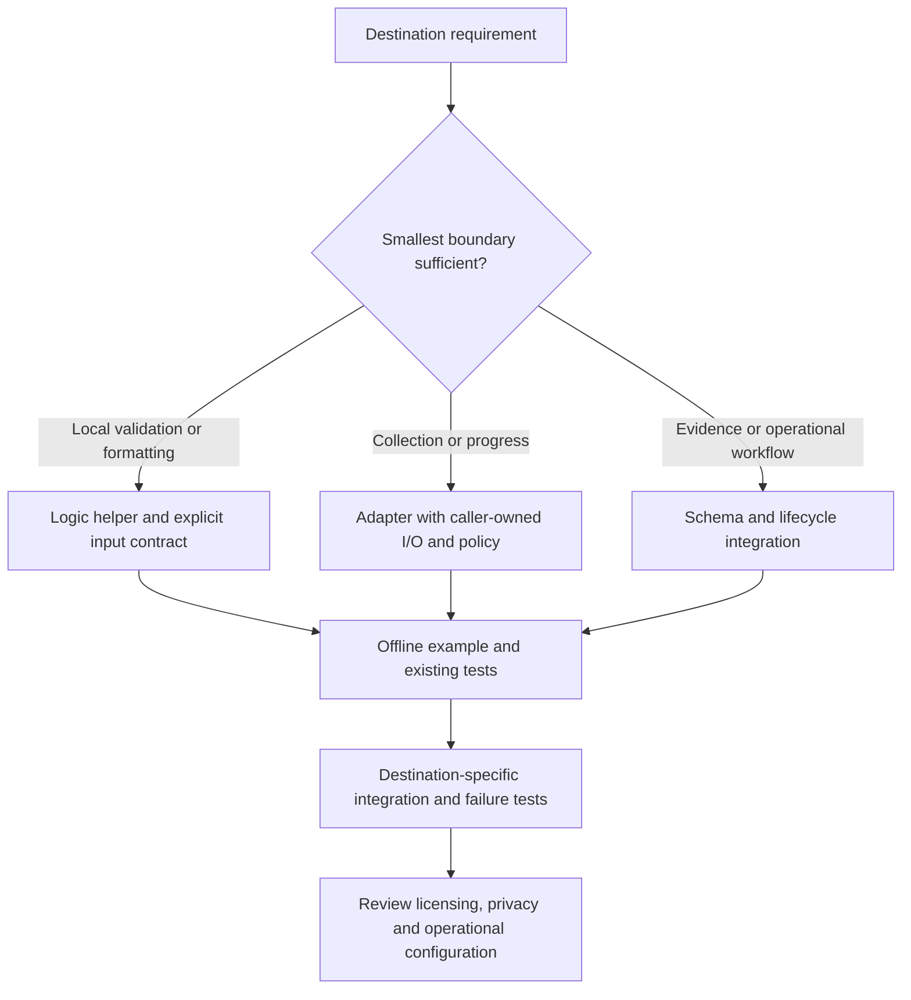
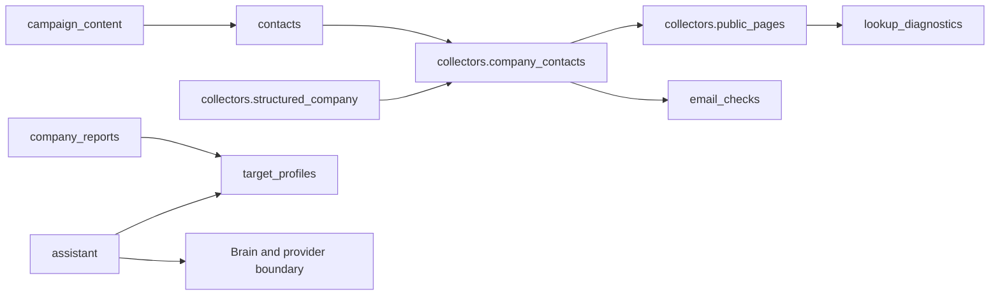

# Reusable components and extraction guide

Code inspected: 2026-10-23. Scope: the implementation in this repository, not a
promise of a stable public SDK or a complete portability audit. No application
code has been extracted or behavior changed by these documents.

For source selection and free/paid research economics, see the
[low-cost research guide](LOW_COST_LEAD_RESEARCH.md).

## Choose the smallest useful boundary

| Component | Current reuse level | Detailed contract |
| --- | --- | --- |
| Inventory filters and contact lifecycle | Query adapter / application-coupled identity and lifecycle | [Inventory and contacts](reuse/inventory-and-contacts.md) |
| Email syntax and ASCII transport policy | Small logic component; one main external dependency | [Email checks](reuse/email-checks.md) |
| Public page reader | Adapter component: injected client and URL policy | [Web extraction](reuse/web-extraction.md) |
| Structured organization fields | Deterministic extraction with transitive collector imports; review/storage coupled | [Web extraction](reuse/web-extraction.md) |
| Signal-profile validation | Small logic within an application-importing module | [Signals and reports](reuse/signals-and-reports.md) |
| Evidence evaluation and company reports | Application-coupled SQL, definitions and report schema | [Signals and reports](reuse/signals-and-reports.md) |
| Discovery provider records and adapters | Adapter seam inside the larger discovery module | [Discovery and research](reuse/discovery-and-research.md) |
| Contact research jobs and adoption | Application-coupled lifecycle, identity, budgets and schema | [Discovery and research](reuse/discovery-and-research.md) |
| Role-title qualification | Small deterministic logic; current module imports API/storage dependencies | [Discovery and research](reuse/discovery-and-research.md) |
| Rich-content rendering | Deterministic schema/renderer with transitive application imports | [Campaigns and delivery](reuse/campaigns-and-delivery.md) |
| Templates, opportunities and delivery readiness | Application-coupled workflows; preserve complete gates | [Campaigns and delivery](reuse/campaigns-and-delivery.md) |
| Phase-local progress and ETA | Small view logic plus settings adapter | [Platform and progress](reuse/platform-and-progress.md) |
| Assistant, derived tasks and dashboard UI | Application-coupled model/query/UI boundaries | [Platform and progress](reuse/platform-and-progress.md) |

**Small logic** means no external operation in that helper, not necessarily no
transitive module imports. **Adapter** means caller-supplied I/O/persistence/policy.
**Application-coupled** means another project must preserve/adapt schema and lifecycle;
copying the named file alone is insufficient. These are qualitative assessments,
not measured effort estimates or compatibility guarantees.



## Selected current dependency edges

Solid arrows below mean selected Python imports, including lazy
email-normalizer and page-reader imports. This is not an exhaustive dependency graph; standard-library
and most third-party imports are omitted. It explains why a deterministic helper may
still load a wider application stack.



## Try the offline example

From the repository root, after setup:

```bash
.venv/bin/python -m examples.reuse.offline_demo
```

[Example source](../examples/reuse/offline_demo.py) uses HTTPX MockTransport,
synthetic `.test` data, a fake clock, an in-memory settings adapter and temporary
SQLite files. It does not read `.env`, connect a mailbox, invoke a model, research
real businesses or touch the active database. It demonstrates existing internal
APIs in the installed checkout; it is not a standalone pip package.

## Extraction checklist

1. Identify the exact helper, its direct/transitive imports and the input/output schema.
2. Separate deterministic logic, network access, storage, review and operational effects.
3. Define destination record identity, cancellation, concurrency, retries and errors.
4. Preserve unknown evidence, provenance, stale-write checks and explicit adoption.
5. Keep sending approvals, suppressions and runtime capability checks if those workflows are retained.
6. Pin/test dependencies and carry relevant tests into the destination project.
7. Inspect the destination integration before claiming it works independently.

Where a page proposes an injected repository, clock or separate package, it is
explicitly an extraction recommendation, not an interface already shipped.

## Licensing and provenance

Application code/local modifications are MIT-licensed: retain the copyright and
permission notice required by [LICENSE](../LICENSE), and keep
[AUTHORS.md](../AUTHORS.md) attribution. Third-party source/assets have their own
terms in [THIRD_PARTY.md](../THIRD_PARTY.md); the application's MIT license does
not relicense every bundled asset. Check the files and dependencies you actually
redistribute. Configuration templates may be copied; credentials, authentication,
SQLite/customer data, product training and private exports must not be transferred.

## Maintenance

Update the relevant contract and module document when behavior changes. Keep
examples runnable and use stable source links instead of copied implementation.
The [wiki overview](wiki/Reusable-components.md) links here; the repository remains
the detailed versioned reference. See [architecture](ARCHITECTURE.md),
[development](DEVELOPMENT.md) and the [module index](INDEX.md).
