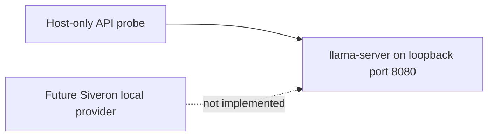

# llama.cpp through an OpenAI-compatible API

Prepared: 2026-10-25. For a colleague already running llama.cpp with **16 GB VRAM**.
This guide tests the local model endpoint and defines the remaining Siveron integration.

**Current status:** Siveron accepts only `claude` and `codex` as Brain providers.
A working llama.cpp endpoint does **not** yet make Siveron's AI features use it.
There is no implemented `openai`/`llamacpp` provider switch or Docker starter package
in this change. Do not add invented configuration keys to `harvey.local.yaml`.

Here “OpenAI-compatible API” means the HTTP request/response format, served locally
by llama.cpp. It does not require an OpenAI account or send requests to OpenAI.
An actual OpenAI-hosted API connection would be a separate integration choice.

## 1. Establish the model endpoint

Use your existing GPU-enabled llama.cpp installation and a chat-capable GGUF model
that already runs on your machine. Record the output of `llama-server --version`.
Start the server with an explicit port so examples do not depend on release defaults:

```bash
llama-server -m /path/to/your-model.gguf --alias siveron-local --host 127.0.0.1 --port 8080 -c 4096
```

On Windows use `llama-server.exe` and your actual model path, quoted if it contains
spaces. Preserve the GPU/offload options that work in your existing setup. The example
is not a GPU build/install recipe and does not guarantee full GPU residency.

Check health and advertised model IDs:

```bash
curl --fail http://127.0.0.1:8080/health
curl --fail http://127.0.0.1:8080/v1/models
```

In Windows PowerShell use `curl.exe` explicitly. During model loading, readiness can
be unavailable; wait for the server to finish loading before testing generation.
If your build does not support an option, inspect `llama-server --help` and record
the version. Keep the model's supported chat template; do not enable tool execution.

Upstream reference for flags and endpoint semantics:
[llama.cpp server README](https://github.com/ggml-org/llama.cpp/blob/master/tools/server/README.md).

## 2. Test a completion without any SDK

Run the following with Python 3. It uses only the standard library. Save it as
`check_local_llm.py` outside private configuration directories, then run
`python check_local_llm.py` (or `python3`/`py -3`, depending on your installation).
In an installed Siveron checkout you can use `.venv/bin/python check_local_llm.py`.

```python
import json
import os
from urllib.request import Request, build_opener, ProxyHandler

# Deliberately fixed to loopback for this host-only test.
base_url = 'http://127.0.0.1:8080/v1'
headers = {'Content-Type': 'application/json'}
# Optional: set this in your terminal only if your server requires authentication.
key = os.environ.get('LOCAL_LLM_API_KEY', '')
if key:
    headers['Authorization'] = 'Bearer ' + key
payload = {
    'model': 'siveron-local',
    'messages': [
        {'role': 'system', 'content': 'Return only a JSON object. No tools.'},
        {'role': 'user', 'content': 'Return exactly {"status":"ok","language":"de"}.'},
    ],
    'stream': False,
    'temperature': 0,
    'max_tokens': 128,
    'response_format': {'type': 'json_object'},
}
request = Request(base_url + '/chat/completions',
                  data=json.dumps(payload).encode('utf-8'), headers=headers)
# Prevent this synthetic local probe from using an environment-configured proxy.
with build_opener(ProxyHandler({})).open(request, timeout=120) as response:
    data = json.load(response)
choice = data['choices'][0]
message = choice['message']
if message.get('tool_calls') or message.get('function_call'):
    raise RuntimeError('Unexpected tool request; nothing was executed')
if choice.get('finish_reason') != 'stop':
    raise RuntimeError('Generation did not complete normally')
result = json.loads(message['content'])
if result != {'status': 'ok', 'language': 'de'}:
    raise RuntimeError('Unexpected structured answer')
print('Local chat completion and JSON smoke test passed')
```

The test submits synthetic text only. If it passes, the endpoint accepts one chat
request and returns the expected JSON. This is a connectivity/syntax smoke test,
not a model capability certification or proof of Siveron integration. No SDK or
OpenAI API key is needed for an unauthenticated loopback server.

## 3. What 16 GB VRAM tells us

We cannot choose an appropriate model from VRAM alone. Please provide:

- Exact GGUF/model identifier, quantization and model license.
- llama.cpp version, GPU model, system RAM and operating system.
- Working launch options and the context size you actually use.
- Typical latency for a short answer and whether the two endpoint tests pass.

Weights, context/KV cache and concurrent requests share available resources.
Start with your already working model and one request at a time. The example's
4096-token context is a starting test value, not a certified Siveron requirement.
Longer application prompts may need a larger context or an explicitly rejected
request; silent prompt truncation must not be used to hide an insufficient limit.

## 4. Network layout, including the planned Docker package



For two processes on the same host, use `http://127.0.0.1:8080/v1`.
Inside a container, that loopback address refers to the container, not the host.
For a future Docker Desktop setup, the candidate host address is
`http://host.docker.internal:8080/v1`; Linux Engine commonly requires an explicit
host-gateway mapping. Neither the hostname nor the mapping makes a server bound
only to host loopback reachable automatically. The bind address and firewall must
be configured and tested for the actual platform. Do not expose an unauthenticated
model server to the LAN/internet merely to make a test work. Server authentication
and a restricted network path are needed when the process is not host-only.

A second design is two Compose services sharing a private network, with the model
service addressed by its service name. GPU passthrough depends on OS/GPU/runtime;
we have not tested that design on your colleague's hardware. Keep model files and
private credentials out of the application image and repository.

## 5. Remaining Siveron work — proposed, not implemented

The inspected boundaries are [BrainConfig](../../harvey/config.py) and
[Brain](../../harvey/brain.py). Brain currently runs the existing provider-specific
text/JSON paths and quota/status handling. A new HTTP provider needs deliberate
integration rather than replacing a command or pretending to be Codex.

| Required adapter work | Acceptance condition |
| --- | --- |
| Explicit base URL, model ID and optional authentication | Validated settings; no credentials in logs or docs; no cloud fallback |
| Text and JSON requests | Correct response parsing plus application-schema validation |
| Runtime boundary | No tool definitions, host capabilities or tool execution; reject tool-call responses |
| Failure handling | Bounded timeout/output, cancellation, loading/error status and truncation handling |
| Usage/status | Report local runtime usage honestly; do not apply subscription-quota semantics |
| API compatibility | Test against the colleague's exact server/model; do not assume all compatible servers behave identically |
| Regression | Existing Claude/Codex version, authentication and capability restrictions remain intact |

Before accepting a new provider/model, tests must cover malformed/extra JSON,
unsupported fields, German/English prompts, long context, unexpected tool calls,
unavailable server, timeout, cancellation and no unintended database/send effects.
The existing [assistant](../modules/platform.md),
[evidence reports](../reuse/signals-and-reports.md) and
[model isolation rules](../../AGENTS.md) remain authoritative.

Do not set `brain.provider: openai` or bypass the current validator: that provider
is not supported yet. A later adapter should use a clearly named separate mode
and explicit capability tests. This documentation does not authorize adding models
to the existing Codex allowlist or expanding its permissions.

## Troubleshooting and what to send back

| Symptom | Next check |
| --- | --- |
| Connection refused | Server running, explicit port, correct host/container address |
| Loading / 503 | Model readiness and available memory |
| Unauthorized / 401 | Own server key; do not share the key in messages |
| Model mismatch | Alias and `/v1/models` response; use the advertised identifier |
| Invalid JSON or length termination | Chat template, available output budget, context and response-format support |
| Extremely slow answer / memory error | Actual GPU offload, context allocation and other GPU workloads |

Send back OS/GPU, version, model/quantization, sanitized launch flags, success/failure
of health and JSON probes, and the error class/HTTP status if relevant. Do not send
keys, authentication files, private prompts or customer records. With that information
we can design and test the adapter instead of guessing the server contract.

## Verification of this guide

Documentation/source inspection: 2026-10-25. Python snippet syntax and four
synthetic response fixtures passed (success, tool-call rejection, truncation and
invalid JSON), without network requests. No llama.cpp server, GGUF
model, GPU run or working Docker starter package has been verified here. Follow
[the standard setup](../../START_HERE_EN.md) for currently supported Siveron use.
