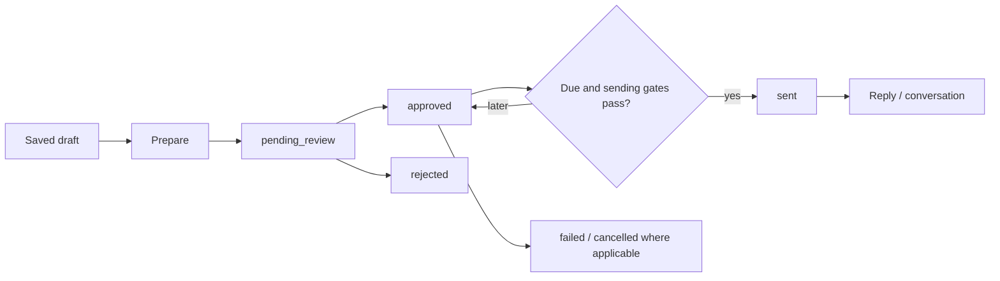

# Outbox, delivery and conversations

Code checked: 2026-10-19. [Index](../INDEX.md) · [Campaigns](campaigns.md)

## Purpose and workflow

Approval permits sending; it is not a delivery receipt. Sender processes due approved
items while respecting delivery pause, configured email channel, daily budget,
recipient suppressions, campaign/contact lifecycle and content/provider checks.
Manual draft paths can make technical verification optional; other paths use the
sender's verification policy. Inspect branch-specific logic rather than broadening
all status sets. A company contact can be eligible without pretending to be a person.

## Sequence spacing (implemented 2026-10-19)

Both manual preparation and native automatic staging snapshot `outbox.delay_days`.
The native sender selects a follow-up only when the exact preceding sequence step
for the same campaign/contact is `sent`, has a readable `sent_at`, and its stored
delay has elapsed. The existing `send_at` remains an additional lower bound.
Provider success means acceptance by the provider, not proof of inbox delivery.
Zero-day successors still require success first and are considered on a later drain.
Failed, rejected, cancelled, unapproved or missing predecessors cannot unlock them.
Reply-kind messages are independent of sequence spacing.

On successful send, the next pending/approved step's schedule is postponed when
needed in the same database transaction; later dates are preserved. Readiness filtering
happens before the batch limit so blocked follow-ups cannot starve other recipients.
Daily caps and all existing suppression/reply/content gates remain in force.

An appended migration infers legacy whole-day spacing only from readable adjacent
scheduled snapshots in the same campaign/contact sequence. Missing/non-whole-day
intervals remain NULL and held; no edited campaign content is used as a fallback.
Migration does not approve messages, restart failed ones or rewrite sent history.
Previously changed snapshot dates cannot reconstruct an unknowable original intent;
per-item legacy diagnosis is displayed by R02b; changing an ambiguous old schedule still requires explicit review, not automatic repair. No live DB was migrated as a test.
Running processes need their normal restart/init to load the new code/schema; no
agent or live delivery was started during implementation.

Tests: `tests/test_sequence_schedule.py` covers late approval, predecessor failures,
daily-cap deferral, zero delay, exact campaign scoping, starvation, replies,
manual spacing snapshots, restarts and legacy migration with a fake provider/temp DB.
Validation: 17 new sequence cases; full Python suite 696 passed / 22 skipped;
3 help-content checks passed (2026-10-19).

The UI uses green for sent and yellow for waiting/queued items. Actual provider
success and state updates determine sent status. Replies/opt-outs stop follow-up
where applicable. Conversations are grouped by stored campaign association; a click
opens the thread in a dialog. Unassigned conversations retain a separate group,
not a guessed campaign based on current contact membership.

## Per-message readiness (R02b, implemented 2026-10-19)

[delivery_readiness.py](../../harvey/delivery_readiness.py) owns stable reason codes,
DE/EN reason/next-action copy, global channel/provider/pause/remaining-UTC-allowance/
quiet-hour checks and per-message approval/schedule/predecessor/contact/content/
attachment assessment. Native Sender invokes this assessment before provider send;
StateManager uses the same module's sequence SQL predicate before its batch limit.
Existing send, stop-on-reply, model isolation and approval protections remain intact.

`GET /api/outbox` enriches the existing lists with `readiness` (state, reasons,
earliest_at, remaining_today) and `readiness_checked_at`. States: ready, waiting,
blocked, unknown, failed, sent. Unknown is not a ready verdict; it does not itself
change stored status or introduce a new send permission. Terminal statuses retain
their existing meaning; historical errors remain visible. The browser shows a primary
reason/action and expandable additional reasons, with direct navigation for applicable
settings/contact/control sections. Navigation does not perform the proposed action.
Tables stack on mobile; live readiness timestamps and effective dates use UTC conversion.
Validation on 2026-10-19: 9 readiness tests passed; full Python suite 705 passed /
22 skipped; 3 help-content checks passed; isolated desktop/mobile DE/EN preview.

The heartbeat records observations of checks it already performs in settings key
`delivery_runtime`: PID, checked_at, model/reply-safety outcomes, approved-only mode
and a hash of relevant non-secret config. Dashboard requires a matching PID/config
and a snapshot no older than twice the heartbeat interval plus 60 seconds (minimum
60 seconds). Missing/stale evidence or changed configuration is unconfirmed, never
green. A failed model availability check is distinct from the existing safe native
approved-only path during exhausted AI quota. No external preflight/connection/model
call is triggered by viewing the outbox. Provider configuration is not proof of a
working live SMTP/Gmail connection; ready remains a time-stamped observation, not a
promise of delivery. Runtime observations are diagnostic, not a second scheduler.

Existing processes require their regular restart to expose the new API/code and
record runtime observations. No live agent is started automatically. Tests:
`test_delivery_readiness.py` covers multiple reasons/read-only API, secret-free
configuration errors, stale/PID/config-mismatched snapshots, quota-only runtime,
content validation, quiet hours, suppression, attachments and sequence parity.

## Implementation map

- [agents/sender.py](../../harvey/agents/sender.py): enqueue/send gates, schedules, failures and sent state.
- [agents/handler.py](../../harvey/agents/handler.py), [main.py](../../harvey/main.py): replies and heartbeat orchestration.
- [integrations/mail_provider.py](../../harvey/integrations/mail_provider.py), `gmail.py`, `smtp_mail.py`, `instantly.py` in the same directory: configured delivery adapters.
- [gate.py](../../harvey/gate.py): pre-send content checks.
- [dashboard.py](../../harvey/dashboard.py): GET `/api/outbox`; POST `/api/outbox/{item_id}/approve`, `/reject`, `/api/outbox/approve-all`; POST `/api/sending/{action}`; GET `/api/conversations`.
- UI: [app.js](../../harvey/web/app.js), `index.html`, `app.css`.
- Tables: `outbox`, `campaigns`, `prospects`, `conversations`, `processed_replies`, `contact_suppressions`, `settings`.

## Constraints, verification and potential

Dashboard running, heartbeat running and delivery enabled are separate states.
Authentication, quiet hours, quotas, due time and daily caps can defer work. A pause
or model failure is not authorization to bypass gates. Do not test with live sending.
Tests: `test_outbox_native.py`, `test_company_contact_sender.py`, `test_inbox_capture.py`,
`test_conversation_groups.py`, `test_sending_settings.py`, `test_email_wiring.py`.
The guided campaign path (R01) opens a campaign-scoped Outbox. Optional
`campaign_id` on GET `/api/outbox` and POST `/api/outbox/approve-all` restricts
both display and bulk approval to that exact campaign using parameterized SQL.
Without it, existing global behavior remains. “Show all campaigns” clears the
browser scope. Tests in `test_campaign_workflow.py` cover cross-campaign isolation,
idempotent preparation and unchanged sending state. See [roadmap](../ROADMAP.md).

R04 adds an explicit history review to manual campaign preparation; see
[campaigns](campaigns.md#repeated-outreach-review-r04-implemented-2026-10-19).
It does not change Sender, approve messages, lift suppressions or rewrite existing
queues. Evidence includes prior outbox addresses even if the contact address changed.

R05/R06 use `_delivery_assessment_context` for shared read-only task/outbox assessment.
Optional `item_id` on GET `/api/outbox` selects an exact stored message, with optional
campaign constraint, independently of ordinary list limits. In the client this view
hides bulk approval and retains explicit single-message decisions. Future approval
insert/update triggers record approved_at; historical NULL values remain unknown.
See [campaign counting rules](campaigns.md#campaign-results-r06-implemented-2026-10-19).

## Templates and sales continuation

See [sales workflows](sales-workflows.md) for implemented template reuse, explicit
opportunities, exact conversation links and due tasks in Today (checked 2026-10-19).

## Shared recipient syntax (2026-10-20)

Gate and Sender reuse email_checks.send_address_valid: robust email-validator syntax
plus the existing ASCII transport restriction. This tightens malformed legacy inputs
without admitting additional address formats or relaxing verification/status gates.
Contact/campaign APIs use the same deterministic flags; DNS evidence remains optional
and independent. See [web extraction](web-extraction.md).

## Reuse contract

Reuse interfaces inspected: 2026-10-23. See the
[detailed reuse guide](../reuse/campaigns-and-delivery.md) for inputs/outputs,
transitive dependencies, data and side effects, failure semantics, extraction steps,
examples and relevant tests. The [catalog](../REUSABLE_COMPONENTS.md) distinguishes
small logic, adapter seams and application-coupled workflows; these modules are
not a separately versioned public SDK.
