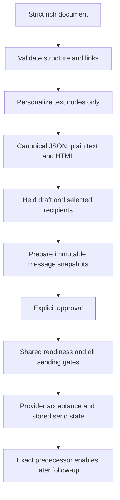

# Reusing campaign content, templates and delivery assessment

Code inspected: 2026-10-23. These are current internal interfaces, not a stable public SDK.
See the [reuse catalog](../REUSABLE_COMPONENTS.md) for classifications and licensing.

## Boundaries and reuse levels

Rich-content validation has a small deterministic core with application imports.
Templates, opportunities and delivery assessment are **application-coupled**.
A reusable text renderer is a much smaller extraction than a complete campaign engine.

## Content helper contract

Source: [campaign_content.py](../../harvey/campaign_content.py).
`rich_content(document, values=None)` returns `(normalized_document, plain, html)`
or raises `ContactError` (a ValueError subclass). Input is a strict `doc` tree with
paragraph/list/blockquote/text/hardBreak nodes and supported text marks. It is not
an arbitrary HTML sanitizer or a general template language.

Limits include 100,000 serialized characters before traversal, 3,000 visited nodes,
maximum depth 25, 15,000 characters per text node and final plain text, and at most
one counted web link/anchor run. It deep-copies and normalizes rather than mutating
the caller's document. Only recognized placeholders (`first_name`, `last_name`,
`company`, `title`, `personalization`) are replaced in text when values are supplied;
HTML is escaped, link attributes do not accept placeholders. `safe_link` allows
HTTP(S)/mailto with its own restrictions; it does not fetch or establish safe destinations.
Unresolved/unknown placeholders still need downstream delivery checks.

Imports include `ContactError` from contacts, which transitively imports collectors.
For a separate library, extract a local exception and define a versioned document
schema; that refactor has not been made. Do not remove the schema checks as a shortcut.

`attachment_ids(value)` validates up to five distinct 32-character lowercase hex IDs.
`load_attachments(db, ids, include_content=False)` requires the attachment table;
limits are 10 MiB per file and 20 MiB total, enforced across the relevant upload/load
paths. `file_type(filename, content)` performs bounded-format checks, not malware
scanning. Copying only it does not reproduce the complete upload policy.

## Templates and opportunities

[sales_workflows.py](../../harvey/sales_workflows.py) provides
`search_recipe(data)` and `opportunity_values(data)` validation (ValueError on invalid
input), plus `install_sales_routes(app, state_factory)` for database-backed operations.
Recipes whitelist providers/options; notably recipe radii are the fixed set
10/25/40/75/100/200 even though assistant discovery supports arbitrary 1–200 values.
Do not assume validators with similar names have identical contracts.

Template instantiation delegates to CRM draft creation. Templates retain sequence/
brief and optional profile/search criteria, but exclude recipients, attachments,
sender secrets, approvals and delivery state. Literal text may still contain personal
data: sanitize it yourself before cross-project sharing. Applying criteria starts no search.

Opportunities depend on exact contact/conversation/campaign links, an incoming reply,
explicit interest and revision-checked storage. Open stages require a next action and
ISO calendar date; won/lost can omit those. Owner is a string, not an authorization
principal. Adapt these semantics deliberately if integrating with another CRM.

## Delivery assessment is not a send API

[delivery_readiness.py](../../harvey/delivery_readiness.py):
`await global_context(state, config, provider, now=None)` reads configuration,
pause/cap state and provider configuration. `await assess_message(state, item,
config, context, runtime=())` returns `state`, reason records, `earliest_at`,
`remaining_today`. It reads contacts, suppressions, campaign policy, predecessor
outbox snapshots and attachment information; it does not itself send or approve.
The mutable context contains a per-assessment cache: do not reuse it indefinitely
while contacts or settings change.

`runtime_codes(raw, pid, now, ttl_seconds, signature=None)` validates observations;
`record_runtime(...)` writes best-effort diagnostic settings. Unknown/stale runtime
is not ready. Preserve the existing caller's freshness/PID/config-signature policy.
An empty default `runtime` argument is not evidence that your runtime is healthy.

For another app, retain approval, recipient identity, verification policy, opt-outs,
reply stops, predecessor success/delay, caps, quiet hours, attachments, runtime checks
and transactional send-state updates as one tested boundary. Do not copy a ready
boolean and discard the sender's own checks. Provider acceptance is not inbox delivery.

## Examples and verification

The [offline example](../../examples/reuse/offline_demo.py) renders synthetic rich
text and validates a closed opportunity without creating mail, opportunities or a
provider. Tests: [content](../../tests/test_campaign_content.py),
[templates/sales](../../tests/test_sales_workflows.py),
[readiness](../../tests/test_delivery_readiness.py),
[sequence spacing](../../tests/test_sequence_schedule.py),
[native outbox](../../tests/test_outbox_native.py).
Destination integration needs fake-provider failure/idempotency/approval tests,
not live test messages. Detailed lifecycle: [delivery module](../modules/delivery.md).
