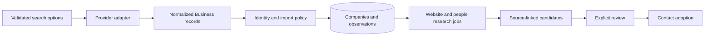

# Reusing discovery and contact research

Code inspected: 2026-10-23. These are current internal interfaces, not a stable public SDK.
See the [reuse catalog](../REUSABLE_COMPONENTS.md) for classifications and licensing.

## Select the boundary before copying

The full discovery and research systems are **application-coupled workflows**.
Provider records and title qualification are smaller seams, but current imports may
still load application dependencies. They are not independent installed libraries.

## Discovery interfaces

[discover.py](../../harvey/collectors/discover.py) defines:

| Interface | Contract |
| --- | --- |
| `DiscoveryQuery` | Dataclass: term, location/category/coordinate, depth, limit and Maps options |
| `Business` | Dataclass: normalized company/site/contact/listing facts and provenance |
| `Business.identity()` | Maps prioritizes external ID over domain; other sources prioritize domain |
| `DiscoveryProvider.fetch(client, env, query)` | Async provider call returning a list of Business records |
| `configured(env)` / `estimate(queries)` | Adapter configuration predicate and numeric spend estimate |
| `run_discovery(state, config, ..., dry_run=False, ...)` | Orchestrates resolution, policy, import and observations; returns DiscoveryReport |

A provider's `env_keys` use its current environment-dict naming. Follow the adapter
rather than assuming arbitrary uppercase variable names. `last_cost` is adapter
state; avoid sharing a mutable provider instance across unrelated concurrent runs
without examining its behavior.

**Preview caveat:** in the current implementation `run_discovery(..., dry_run=True)`
returns before business fetch/import, but listing coordinate resolution occurs before
that return and may read cache or perform geocoding. Do not use it as a guarantee of
zero network or zero side effects. Pure unit tests should inject/mimic resolution,
or call `provider.estimate()` with already constructed queries.

The full path loads environment settings, uses StateManager, confirmed signals,
provider quotas/budgets, geocoding, import identity and observation policies. The
separate [pipeline](../../harvey/pipeline.py) also profiles and optionally looks up
emails. Maps additionally needs Playwright, Chromium, checkpoint state and radius
policies. Preserve login/CAPTCHA stops and source-specific coverage limits.

## Contact research interfaces

[contact_research.py](../../harvey/contact_research.py) owns `ResearchSettings`,
`ResearchService(sm)` and route installation. `await service.create(contact_id,
{'sources': [...], 'mode': 'quick'|'thorough'})` snapshots contact/settings, records a
running job and **starts an asyncio task**. This is not just object construction.
Enabled sources are `website`, `web`, `profiles`, `hunter`; provider settings,
query/page/monthly budgets and opt-outs remain authoritative.

`await service.snapshot(job_id, contact_id)` exposes persisted progress/findings;
stop requests are checked at bounded work boundaries. Old-process running records
become interrupted and do not silently resume paid calls. Findings live in
`contact_email_findings`, runs in `contact_email_research`; contact identity,
suppressions/settings and other tables are also required. Adoption remains a
separate revision/fingerprint-checked route. Reusing the worker alone must not
silently overwrite an address, mark it verified or contact that person.

[ContactJobs](../../harvey/collectors/contact_jobs.py) is another orchestration
boundary for company email/people jobs. Do not assume it and ResearchService share
storage, lifecycle or return schema merely because both perform research.

## A smaller reusable piece: role qualification

[decision_makers.py](../../harvey/decision_makers.py): `criteria(payload)` validates
supported role IDs; `qualify(title, chosen)` returns `verdict`, `roles`, `reason`,
`title`. Deterministic German/English regexes yield match/no_match/unknown. A support,
former or intern title takes precedence over a positive leadership match. A match
is a review hint, not proof of identity, purchasing authority or outreach consent.
The file imports FastAPI/aiosqlite at module load; extracting a pure title module
would be a future refactor. `qualify_job` adds snapshots and database writes.

## Reuse steps and checks

1. Start with a provider adapter or title classifier if that meets the destination need.
2. Supply explicit provider settings and budget policy; never copy `.env` or credentials.
3. Define destination deduplication, job state, cancellation and transaction semantics.
4. Keep evidence separate from contact adoption and sending.
5. Preserve source/version provenance and retest failure/restart cases.

Example: [offline_demo.py](../../examples/reuse/offline_demo.py) exercises role
qualification and constructs a query without running a provider.
Tests: [discovery](../../tests/test_discover.py),
[Maps](../../tests/test_google_maps.py), [pipeline](../../tests/test_pipeline.py),
[contact research](../../tests/test_contact_research.py),
[decision-makers](../../tests/test_decision_makers.py),
[contact jobs](../../tests/test_contact_jobs.py).
