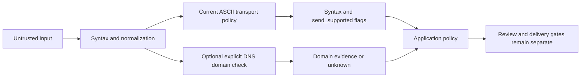

# Reusing email checks

Code inspected: 2026-10-23. These are current internal interfaces, not a stable public SDK.
See the [reuse catalog](../REUSABLE_COMPONENTS.md) for classifications and licensing.

## Purpose and reuse level

`email_checks.py` is a **small logic component** suitable for form validation and
transport-policy indicators. Domain DNS checking is an **adapter component** in the
larger company-contact collector. Neither establishes mailbox ownership or consent.

## Current interfaces

Source: [email_checks.py](../../harvey/email_checks.py).

| Function | Contract |
| --- | --- |
| `email_checks(value)` | Trims string input; nonstrings become empty. Returns `syntax_valid`, `send_supported`, `reason` |
| `send_address_valid(value)` | Returns the `send_supported` boolean only |
| `normalize_public_email(value)` | Returns normalized lowercase address or `None`; rejects selected placeholder domains and image-like suffixes |

Reasons are `empty`, `syntax_invalid`, `transport_unsupported`, `ready`.
`ready` here means syntax plus the existing ASCII transport regex only. It is
unrelated to outbox readiness and does not prove DNS, mailbox deliverability,
verification status, identity or permission to contact.

Dependencies: Python `functools`/`re` and `email-validator` (declared as
`>=2.3,<3`; use the lockfile for the current resolved environment). Syntax uses
`check_deliverability=False, test_environment=True`. Fixture `.test` addresses are
accepted; this is not an internet-domain existence check. Lowercasing is the current
application storage policy, not a universal email local-part normalization rule.
There are process-local 4096-entry LRU caches. Pass strings to the public normalizer;
its cached wrapper requires hashable input before the function converts to string.

## Optional DNS layer

`await check_email_domain(email)` in
[company_contacts.py](../../harvey/collectors/company_contacts.py) returns
`mail_domain_present`, `no_mail_domain` or `unknown`. The caller should validate
syntax first. It uses email-validator and a dnspython resolver with a thread-safe
1024-entry TTL-aware LRU cache, two-second resolver lifetime and three-second outer
async wait. A cancelled/expired wait does not guarantee an underlying worker thread
has stopped immediately. No SMTP probe or test email is sent.

A temporary failure remains unknown. `no_mail_domain` is explicit domain-level
undeliverability, not proof about a named mailbox. Concurrent cache misses are not
promised to coalesce. This function's current module imports HTML/browser/collector
helpers, so copying only this function requires replacing those dependencies or
extracting a new adapter boundary with tests.

## Reuse recipe

1. Use the small logic file and its declared library dependency for a local validator.
2. Decide whether the destination shares the ASCII-only transport and lowercase-key
   policy. A policy change needs migration/dedup/suppression review, not just a regex edit.
3. Keep DNS evidence separate from syntax flags and from provider mailbox verification.
4. Preserve unknown results; never turn a timeout into an invalid mailbox.
5. Keep destination approval and suppression checks outside these helpers.

Example: [offline_demo.py](../../examples/reuse/offline_demo.py) verifies a synthetic
`.test` address and malformed input without DNS. It also checks public placeholder
exclusion. Tests: [email checks](../../tests/test_email_checks.py),
[native outbox](../../tests/test_outbox_native.py), [sender](../../tests/test_company_contact_sender.py).
For DNS adaptation retain the existing mocked TTL, expiry and transient-failure tests;
do not test deliverability by contacting a real recipient.
