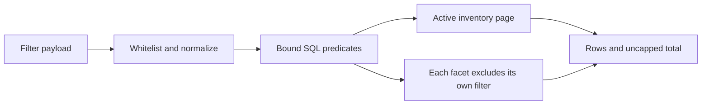

# Reusing inventory filters and contact lifecycle

Code inspected: 2026-10-23. These are internal interfaces, not a stable public SDK.
See the [reuse catalog](../REUSABLE_COMPONENTS.md).

## Inventory filter contract

[company_filtering.py](../../harvey/company_filtering.py) combines deterministic
validation/SQL assembly with an **application-coupled** SQLite reader. It is useful
as a faceted-search pattern, not a generic ORM or browser-side SQL API.

| Interface | Contract |
| --- | --- |
| `validate_filters(raw)` | Dictionary to normalized whitelisted filters; raises ValueError on unknown keys or invalid values |
| `where(filters, exclude=None)` | Already validated filters to `(SQL WHERE fragment, bound parameters)` for the hard-coded `c` company alias |
| `await page_data(path, page, filters)` | Database path, positive page and validated filters to a paginated inventory/facet dictionary |

Fields are `q`, `locations`, `industries`, `source` and binary email/website/phone/
people/profiles. Binary values are empty/with/without. Location/industry arrays
accept at most 50 entries; different fields combine with AND, values within a
selected array with OR. Text search uses casefolded literal substring matching,
not user-supplied SQL. Validate at the entry boundary: `where` and `page_data` are
not substitutes for `validate_filters` or positive-page validation.

The result contains `items`, `total`, `page`, `page_size` (30), `pages`, `filters`
(location/industry option lists), `facets`. Pages are capped at the last page;
facet options span active inventory and counts apply all *other* active filters.
This is disjunctive faceting, not counts limited to the displayed page.

Storage dependencies include companies, prospects, contact_trash,
company_public_emails and company_social_profiles. The reader registers SQLite
functions `valid_company_email` and `company_contains` and starts a read transaction.
It imports `valid_email` from the collector, whose transitive dependencies include
HTTP/extraction/DNS code. For a different schema, retain filter semantics but write
an adapter/query implementation for that schema; the current WHERE fragment cannot
simply be attached to arbitrary tables. Neither row search nor facet calculation
runs a web search or creates contacts.

## Contact creation is a lifecycle operation

[contacts.py](../../harvey/contacts.py):
`await create_contact(state, payload, candidate_id=None, contact_id=None)` handles
manual creation, evidence adoption and editing. Inputs include company id, type
(person/company), name/title/email/phone and optional new-company name/website.
Invalid/conflicting changes raise `ContactError`. Do not treat it as a generic
INSERT helper: current-field, evidence, duplicate/trash/suppression and transaction
rules depend on how the call is made. See its callers and
[contacts module](../modules/contacts.md) before integrating.

[crm.py](../../harvey/crm.py) supplies blocking and recoverable trash. Blocking,
opt-out and trash are different concepts: unblocking must not erase an opt-out;
restoring a contact must not restart cancelled mail. Remote campaign pauses use
a separate pending operation rather than pretending a local write proves remote
success. These behaviors touch contacts, suppressions, queues and linked campaigns.
Reusing the complete lifecycle requires all these policies and database migrations,
not just the contact editor form.

## Integration and validation

1. Reuse `validate_filters` semantics with a destination-owned query adapter.
2. Define durable company/contact identity and exact deduplication keys.
3. Preserve evidence review, stale-value checks and transaction boundaries.
4. Keep reversible list removal/trash distinct from permanent deletion and suppression.
5. Use a temporary database and fake external providers to verify the destination.

The [offline example](../../examples/reuse/offline_demo.py) validates literal filters
and checks a temporary-database inventory page without HTTP or contact adoption.
Tests: [filters](../../tests/test_company_filters.py),
[pagination](../../tests/test_company_pagination.py),
[cleanup](../../tests/test_company_cleanup.py),
[contact actions](../../tests/test_crm_actions.py),
[people adoption](../../tests/test_people_contacts.py).
