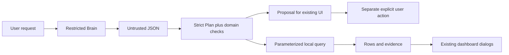

# Reusing assistant plans, progress and UI patterns

Code inspected: 2026-10-23. These are current internal interfaces, not a stable public SDK.
See the [reuse catalog](../REUSABLE_COMPONENTS.md) for classifications and licensing.

## Reuse levels

The progress view is a small deterministic component; persistence needs a tiny
settings adapter. The assistant is an **application-coupled workflow**. Individual
schemas are useful patterns but imports currently include Brain, configuration,
FastAPI, SQLite and target-profile services. The dashboard UI is not an independent
component package.

## Assistant contracts

[assistant.py](../../harvey/assistant.py) contains Pydantic `Settings` and `Plan`
with strict typing and extra fields forbidden. `Plan.model_validate(payload)`
performs schema validation; **also call `.checked(signals)`** for term bounds and
known-signal/action requirements. Schema validation alone is not all domain policy.
Actions are help, navigate, discover, companies, signal_summary, signal_companies,
clarify. No send/approval/delete/research-start action is in this plan contract.

`await generate_plan(sm, prompt)` invokes the configured Brain and has an external
model/cost boundary. It returns model JSON, not automatically a trusted Plan.
`await inventory(sm, plan, limit)` uses parameterized substring predicates and the
existing company schema; signal queries delegate to target profiles. `summary`
returns per-signal counts; overlap means they are not unique category totals.
Routes own enabled-feature checks, bounded history/help context, concurrency and
error responses; reusing the helper alone does not reproduce those controls.

A destination app should define its own strict allowed-action schema, injected model
boundary, repository adapter and permission checks. These are proposed extraction
steps, not an existing generic assistant SDK. Keep untrusted text out of SQL and
never treat a model proposal as user authorization. Preserve the pinned runtime
checks if retaining Siveron's Brain/Codex integration.

## Progress contracts

[discovery_progress.py](../../harvey/discovery_progress.py):
`DiscoveryProgress(state, clock=time.time)` initializes an in-memory run snapshot.
`await update(event)` writes JSON using `state.set_setting('discovery_progress', ...)`;
`await finish(status='completed')` records completion. The minimum injected state
contract is async `set_setting(key, value)`, making it a good adapter seam.

`progress_view(data, running, now=None)` returns a presentation dictionary, omits
internal samples and adds `elapsed_seconds`, `eta_seconds`, `waiting`. If the worker
is gone but stored status is running, it presents interrupted. ETA is a phase-local
range derived from at least two fresh samples, never a total-job guarantee.
Events use the known keys in `update`; this is not an arbitrary event store.
Only the latest run uses this settings key. For multiple jobs/tenants, namespace
keys and define concurrency/recovery rather than sharing it unchanged.

The [offline example](../../examples/reuse/offline_demo.py) injects an in-memory
settings store and fake clock, then checks phase ETA/interruption without a database.
It also validates a discovery Plan without generating model output.

## UI and documentation reuse

JavaScript in `harvey/web/` relies on DOM IDs, global app state, API payloads,
localization conventions and shared dialog/styles. Reusing one feature script in
another app requires a UI adapter or a refactor; copying only CSS/JS is insufficient.
Deep Chat and other vendored assets retain their separate licenses. Read
[THIRD_PARTY.md](../../THIRD_PARTY.md) before redistribution.

User help source is `harvey/web/help-content.js`; export paired manuals rather
than editing generated files. For another app, remove Siveron-specific workflows,
rebuild the help index and retain provenance/license information.

Tests: [assistant](../../tests/test_assistant.py),
[progress](../../tests/test_discovery_progress.py),
[derived tasks](../../tests/test_work_items.py),
[help export](../../tools/help-guide/content.test.cjs).
Work-item derivation is coupled to conversations, outbox readiness and opportunities;
it is not a generic notification service.
