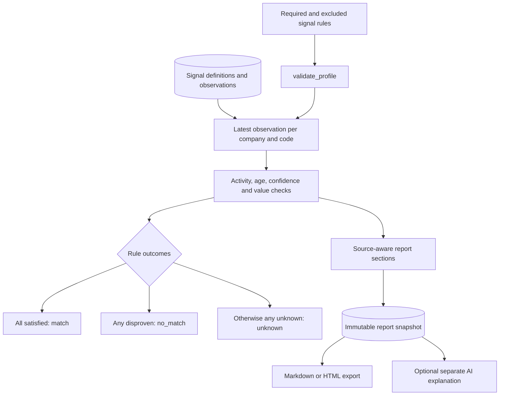

# Reusing signal evaluation and evidence reports

Code inspected: 2026-10-23. These are current internal interfaces, not a stable public SDK.
See the [reuse catalog](../REUSABLE_COMPONENTS.md) for classifications and licensing.

## Reuse level and useful applications

Use these patterns for evidence-backed inventory classification or review reports.
Validation and renderers are deterministic logic; the evaluator and report builder
are **application-coupled** to Siveron's SQLite schema. No separate rules-engine or
report SDK is currently published.

## Evaluator contract

Source: [target_profiles.py](../../harvey/target_profiles.py).

- `validate_profile(payload, signals)` returns normalized `name`, sorted unique
  `require`/`exclude` code lists and `max_age_days`; raises `ValueError` for invalid
  input. `signals` must support code membership. At least one rule is required,
  sets must be disjoint, name is 1–120 trimmed characters, age is 1–365 days.
- `await evaluate_profile(state, profile, company_ids=None, page=1, verdict='all')`
  reads `_connect()` using `aiosqlite`, not a general repository protocol.
  Supply validated criteria and validate pagination/verdict at your entry boundary;
  the direct evaluator is not the HTTP route validator.
- Returns `profile`, `counts`, `total`, `page`, `pages`, `items`, `checked_at`,
  `stage`, `policy`, `scope`. Items contain company id/name, verdict and evidence.
  Counts cover the selected inventory before verdict pagination; items are 30/page.
  An explicit empty company ID list means empty scope, not all companies.

Database dependencies: `companies` (including `removed_at`), `signal_codes`
(status/type/confidence floor/collector) and `observations` (company/code, value,
confidence, evidence URL, observed_at). SQLite window functions choose the latest
record. Invalid-date observations are deliberately prioritized as unknown rather
than falling back to older positive evidence. Future evidence beyond five minutes,
stale/missing evidence, inactive codes, unusable values or confidence below the
floor remain unknown. Current time is read internally; no clock parameter exists.

Boolean values must be 0/1. Nonboolean text/numeric values establish presence, not a
threshold comparison. Excluding a boolean requires explicit false evidence; absence
is not false. An actually disproven rule wins over another unknown rule.
No observations, activations, contact records or approvals are changed by evaluation.
The evaluator reads inventory and matching evidence into memory: 30-row pagination
does not mean 30-row database evaluation or constant-memory scalability.

## Report contract

Source: [company_reports.py](../../harvey/company_reports.py).
`validate(payload)` accepts only `company_ids` (1–20 strings), supported `categories`,
`language` (`de`/`en`) and age (1–365). It returns normalized option values or raises
`ValueError`. `await create_reports(sm, payload)` evaluates evidence, constructs
schema-version-1 snapshots and inserts them into `company_reports` in a transaction.
The company must still be active at write time. It returns a list of snapshots.

Each report has `id`, `schema_version`, `company`, `language`, `categories`,
`max_age_days`, `created_at`, `findings`, `counts`. Findings retain value, code,
confidence, source, time, reason, category, label, section and recommended action.
Sections are `potential`, `context`, `unknown`; a usable HTTP(S) source is required
before observed evidence can be promoted to a finding. Potential is conditional
advice, not a measured business impact. `markdown(report)` and
`report_html(report, printing=False)` consume this schema; they are not generic
renderers for arbitrary JSON. Preview HTML escaping is tested.

`get_report(sm, rid)` hides reports for removed companies and adds stored `ai` data.
`explain(sm, report)` separately calls the existing Brain and validates bounded
structured output for at most six nonunknown facts. The route owns the concurrency
lock and AI-version cache, not the direct helper. Reuse of reporting need not enable AI.
It does not run a fresh audit, establish legal compliance or guarantee rankings/revenue.

## Integration recipe

1. For the existing API, retain StateManager migrations and the schema above.
2. For another database, create a new evidence-access adapter and separate the
   evaluator from SQL/time. Those interfaces are proposals, not shipped APIs.
3. Preserve latest-evidence, unknown and confidence rules with explicit fixtures.
4. Replace category labels/recommendations if your domain differs; version snapshots
   and export contracts. Do not import sales-specific interpretations unchanged.
5. Treat report creation as a database write, evaluation as a read, and AI explanation
   as an optional external call with its own cost/privacy boundary.

The [offline example](../../examples/reuse/offline_demo.py) builds a temporary SQLite
inventory, evaluates a proposed signal as unknown and creates/exports an unknown-evidence
report without AI, real research, business configuration or changes to private state.
Tests: [target profiles](../../tests/test_target_profiles.py),
[company reports](../../tests/test_company_reports.py).
