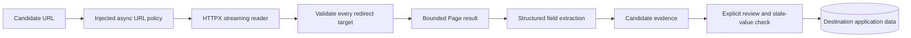

# Reusing public page reading and structured extraction

Code inspected: 2026-10-23. These are current internal interfaces, not a stable public SDK.
See the [reuse catalog](../REUSABLE_COMPONENTS.md) for classifications and licensing.

## Purpose and boundaries

Use this pair for a bounded public-page import or an evidence-review application.
Reading HTML, extracting candidates and adopting a value are three independent steps.
The reader is an **adapter component**; extraction is deterministic but its current
module has transitive imports. The complete review workflow is **application-coupled**.

## Interfaces and contracts

| Interface | Input | Output / failure |
| --- | --- | --- |
| `PublicPageReader(client, guard, **limits)` | Async HTTPX-compatible client; async `guard(url) -> bool` | Reader with job-local cache and lock |
| `await reader.read(url)` | URL string | `Page(html, url, diagnostics)`; most fetch failures return empty HTML with diagnostic codes |
| `extract_company_fields(html, source, domain, company_name)` | Bounded HTML, source URL, lowercase official host without `www.`, expected company name | Up to 40 dictionaries with `id`, `field`, `value`, `source_url`, `entity`, `contact_label`, `method` |
| `await save_structured_fields(state, company, html, source)` | State with `_connect()`, Company-like record | Writes candidate evidence to `company_field_candidates`; does not adopt values |

Reader defaults: 15-second whole-read timeout, 1,000,000 decoded bytes, three
request iterations including redirects, 16 cached URL results, 60-second cache.
Content types are checked by configured substrings, default `('html',)`.
The cache includes failed results and serializes reads on that instance; it is not
a distributed cache, durable history or a general HTTP retry mechanism.
Cancellation propagates. An HTTP 429/5xx diagnostic may be retryable without the
reader automatically retrying it. The supplied client has its own timeout policy.

Diagnostic codes include `timeout`, `network_error`, `unsafe_or_external_url`,
`http_error`, `unsupported_content`, `page_too_large` and `redirect_limit`.
Diagnostic source URLs remove query, fragment and user-info; the returned Page URL
and cache key are not equivalently sanitized. Sanitize them before logging/export.

## Dependencies and extraction behavior

Sources: [public_pages.py](../../harvey/collectors/public_pages.py),
[structured_company.py](../../harvey/collectors/structured_company.py),
[lookup_diagnostics.py](../../harvey/lookup_diagnostics.py).
The reader needs HTTPX plus the diagnostic helper; it does not own the HTTP client.
The structured adapter uses extruct JSON-LD/Microdata and lazily imports
`company_contacts.normalize_email`, which pulls in a larger collector dependency
chain. A one-file copy of the extractor is therefore not a standalone package.

Recognized Organization/LocalBusiness types must match the normalized company name
or publish an explicit URL at the supplied official host. This is a heuristic,
not identity verification. In-document identifiers resolve ContactPoint/PostalAddress;
conflicting declarations are skipped. Extraction does not fetch remote references.
Missing/irrelevant/unsupported data can return `[]`, which does not mean the company
has no phone, address or email. Parser limits do not establish an OS-level sandbox.

## Integration recipe

1. Keep a caller-owned async client and a restrictive async URL guard. For production,
   adapt the existing official-host/public-address policy, including redirects.
2. Bound HTML before parsing. Never replace the guard with an unconditional `True`
   against real URLs. The offline example's allowlist is paired with MockTransport.
3. Use candidate fields as unverified evidence with provenance. Define your own record
   identity and review storage rather than copying Siveron's database IDs blindly.
4. Preserve expected-value/revision checks when replacing saved fields. Accepting an
   email must not silently create a contact, mark it verified or schedule outreach.
5. If extracting a separate package later, inject email normalization and diagnostics
   explicitly. This is a proposed seam, not an interface already implemented.

## Example and verification

Run the [offline reuse example](../../examples/reuse/offline_demo.py): it reads mock
HTML, extracts a published phone and checks diagnostic behavior without real HTTP.
Tests: [reader](../../tests/test_public_pages.py),
[structured extraction/review](../../tests/test_structured_company.py).
Retest redirect escape, private addresses, decoded-size overflow, malformed markup,
ambiguous entities, cancellation, stale adoption and absence of contact/outbox writes
in the destination application. No live website coverage is claimed.
