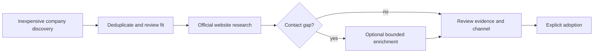

# Low-cost lead research

The cost-effective starting point is **company discovery → fit review → official
website research → selective enrichment**. Count a listing, a matching company
and a reviewed company/contact record as different outcomes.

## Choose a route

| Route | Best use | What still needs review |
| --- | --- | --- |
| OpenStreetMap | Company discovery without a paid search account | Coverage, identity and available contact fields |
| Google Maps local | Small/local samples through Siveron's browser integration, without search API fees | Browser time, page changes, incomplete coverage, terms and contact evidence |
| Geoapify / SerpApi Free | Additional category-based places or organic website search within your account allowance | Overlap, actual account quota and adapter limitations |
| DataForSEO / Serper | Controlled paid listing or organic search where coverage/effort justifies it | Upfront credit purchase, consumed cost, duplicates and enrichment |
| Official websites | Published company email/phone/address and person/role evidence | Currentness, association and explicit adoption |
| Optional Hunter | Selected missing email information for existing named contacts | Provider credits, source evidence and review; not automatic verification |

The local Google Maps integration is **not the official Google Places API**. It
needs no search API key or separate scraper service, but browser/runtime/review
costs remain. It does not bypass login/CAPTCHA blocks or guarantee full coverage.
Its listing adapter does not itself provide emails or named decision-makers.

## Three budget approaches

1. **No paid service:** small OSM/local Maps sample, optional verified free
   allowances, then public website research. Minimize service fees while measuring time.
2. **Selected spending:** use paid search/enrichment only for relevant gaps after
   deduplication. A low consumption cost can still require a larger prepaid purchase.
3. **Repeated/larger batches:** pilot sources, compare useful yield and total effort,
   then scale the route that works for your own market. No universal cheapest provider.

These are planning approaches, not automatic presets or authorization to start work.
The neutral development environment keeps channels disabled and sending paused.

## Prices and actual integration support

The [detailed source and budget guide](https://github.com/nexdevn-dot/SIveron_Hervay2.0/blob/main/docs/LOW_COST_LEAD_RESEARCH.md)
contains the dated official pricing references (**2026-10-23**), imported-field
matrix, account requirements and worked cost examples. Prices are centralized
there to reduce drift across pages.

An advertised provider feature is not automatically a Siveron feature. In particular,
Siveron's SerpApi discovery adapter blocks paid or unknown plans. Local free-quota
counters do not see usage in other apps or prove that every account is free of charges.
Hunter's provider credits differ from local research request budgets.

## Measure useful yield

Compare consumed service cost **and** runtime/review time per relevant company with
at least one reviewed channel of the type you need. Keep named people, company
mailboxes and phone channels separate. Deduplicate companies before calculating
yield. A published address is not automatically a verified mailbox or permission
to contact; adoption, campaign approval and delivery remain separate steps.

The combined cost metric is guidance for your bookkeeping, not a claim that Siveron
already implements a complete cross-provider cost-per-qualified-contact dashboard.

Further reading: [Features and workflow](Features-and-workflow),
[Configuration and integrations](Configuration-and-integrations),
[Reusable components](Reusable-components).
