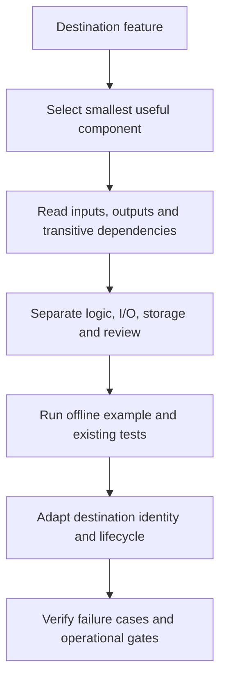

# Reusable components

Siveron contains useful building blocks for other applications, but it is not a
collection of independently packaged libraries. Start with the smallest boundary
that solves your problem, then inspect the detailed contract and dependencies.

## Component map

| What you want to reuse | Current boundary | Detailed guide |
| --- | --- | --- |
| Email syntax and transport checks | Small logic helper | [Email checks](https://github.com/nexdevn-dot/SIveron_Hervay2.0/blob/main/docs/reuse/email-checks.md) |
| Bounded HTML downloads and structured organization fields | Client/policy adapter plus extraction and explicit review | [Web extraction](https://github.com/nexdevn-dot/SIveron_Hervay2.0/blob/main/docs/reuse/web-extraction.md) |
| Company filters, facets and contact management | Query/schema adapter and lifecycle | [Inventory and contacts](https://github.com/nexdevn-dot/SIveron_Hervay2.0/blob/main/docs/reuse/inventory-and-contacts.md) |
| Evidence classification and company reports | Database-backed evaluator and versioned snapshots | [Signals and reports](https://github.com/nexdevn-dot/SIveron_Hervay2.0/blob/main/docs/reuse/signals-and-reports.md) |
| Discovery adapters, role qualification and research | Smaller adapter/helper seams inside coupled workflows | [Discovery and research](https://github.com/nexdevn-dot/SIveron_Hervay2.0/blob/main/docs/reuse/discovery-and-research.md) |
| Rich text, templates and delivery assessment | Renderer plus application-specific review and sending gates | [Campaigns and delivery](https://github.com/nexdevn-dot/SIveron_Hervay2.0/blob/main/docs/reuse/campaigns-and-delivery.md) |
| Assistant plans and progress reporting | Strict schema, query/model boundaries and settings adapter | [Platform and progress](https://github.com/nexdevn-dot/SIveron_Hervay2.0/blob/main/docs/reuse/platform-and-progress.md) |

Small logic does not necessarily mean a module has no transitive application
imports. A helper can be deterministic while its containing file also imports API,
collector or storage code. The guides identify these cases explicitly.

## Reuse without accidental side effects



The detailed guides include Mermaid diagrams, function contracts, data and failure
semantics, extraction steps and test references. Suggested new repository adapters
or independent packages are explicitly proposals, not shipped public APIs.

## Run the offline example

After installing a checkout, run from its root:

```bash
.venv/bin/python -m examples.reuse.offline_demo
```

The [example source](https://github.com/nexdevn-dot/SIveron_Hervay2.0/blob/main/examples/reuse/offline_demo.py)
uses mock HTTP, synthetic `.test` records, a fake clock and temporary SQLite. It
exercises email validation, structured fields, title qualification, rich text,
assistant-plan validation, progress, inventory, evidence evaluation and report
export. It performs no real research, model call or mail delivery and does not
use the private database or credentials.

## Important distinctions

- Syntax-valid email is not a verified mailbox or permission to contact.
- Missing evidence remains unknown, not a negative fact.
- Extracting a candidate is separate from adopting a value or creating a contact.
- A report is a snapshot of stored evidence, not a fresh comprehensive audit.
- A discovery dry run can still resolve coordinates; it is not a blanket zero-network guarantee.
- Delivery assessment is not approval, a send call or an inbox-delivery guarantee.
- UI scripts depend on the existing DOM, state, localization, API and styles.

## License and maintenance

Retain required MIT notices and attribution when reusing application code. Review
third-party files and dependencies under their own licenses. Never transfer private
configuration, authentication, databases, customer records or trained product data.

The [versioned reuse catalog](https://github.com/nexdevn-dot/SIveron_Hervay2.0/blob/main/docs/REUSABLE_COMPONENTS.md)
is the detailed reference. Source inspection date: **2026-10-23**. These are current
internal interfaces, not a stable SDK compatibility commitment.

## Source and budget choices

[Low-cost lead research](Low-cost-lead-research) compares free/local discovery,
paid data and selective contact enrichment. Its detailed repository guide contains
dated provider references, imported fields, integration restrictions and practical
budget approaches. A source offering a paid plan does not mean the current adapter
supports that plan. Keep research, evidence review, adoption and outreach separate.
